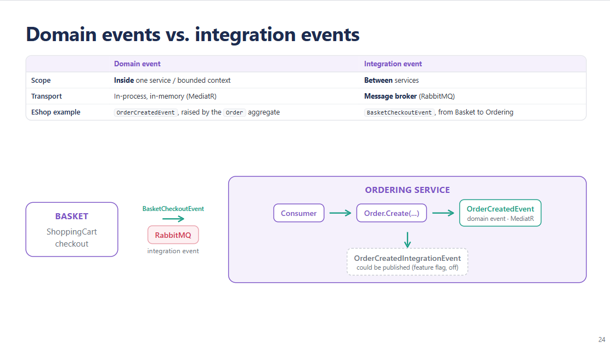
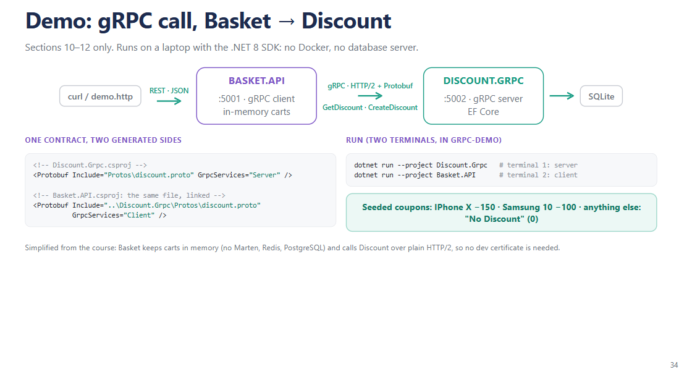
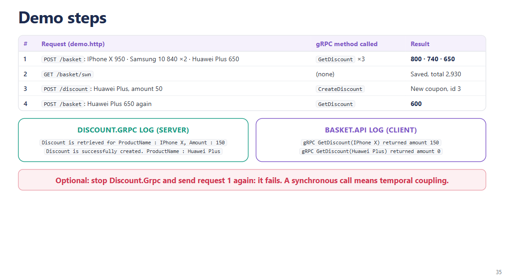
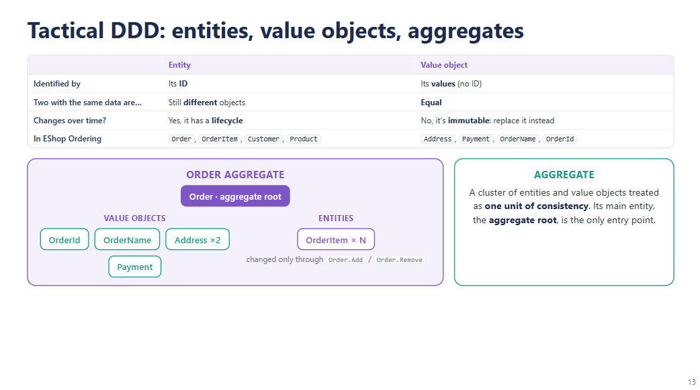
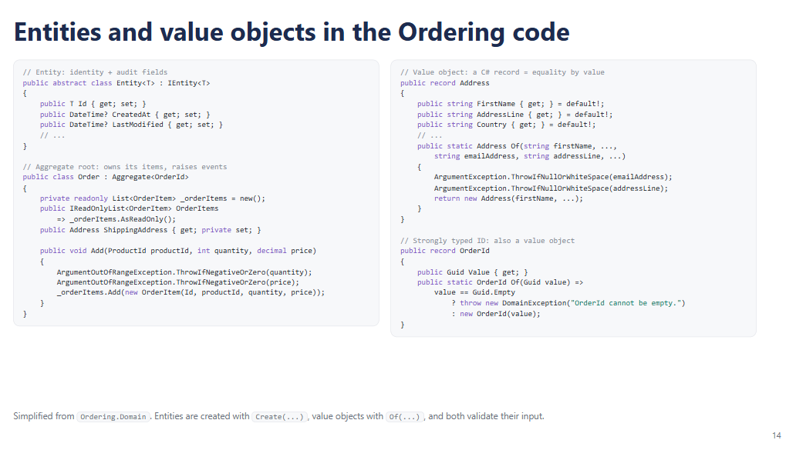
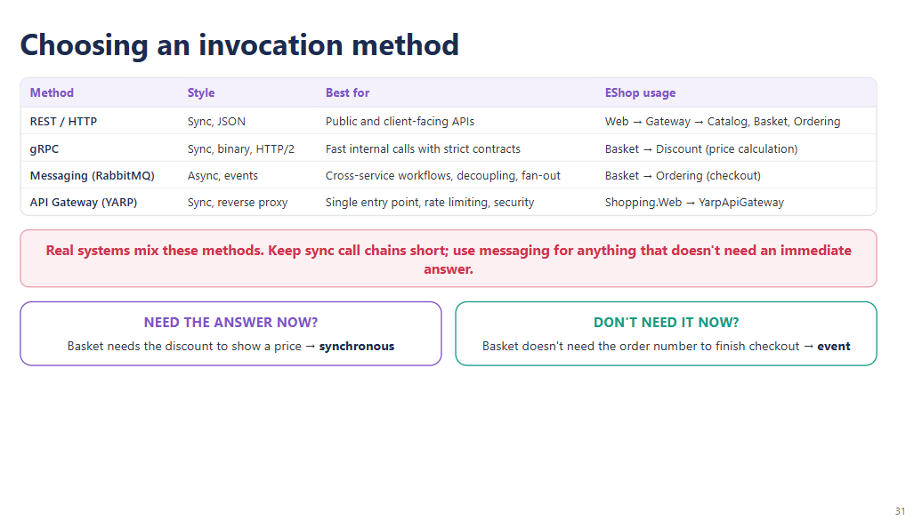

# Kịch bản thuyết trình: Microservices với .NET 8 (60 phút)

Đi kèm với `microservices-slides.md`. Mỗi mục bên dưới tương ứng với một slide. Con số trong ngoặc vuông là **mốc đồng hồ mục tiêu khi bạn rời slide đó**, để bạn kiểm tra tốc độ của mình trong lúc nói.

Giả định: nói với tốc độ vừa phải, có ngắt nghỉ ngắn ở các slide code và diagram. Phần lời nói tương đương bản tiếng Anh (khoảng 44 phút); phần demo và các lúc ngắt nghỉ lấp đầy thời gian còn lại. Bản tiếng Việt chưa được bấm giờ thực tế, nên hãy đọc thử một lượt và điều chỉnh các mốc nếu cần. Các dòng *in nghiêng* là chỉ dẫn sân khấu, không đọc thành lời.

Quy ước: thuật ngữ kỹ thuật, tên pattern, tên class/method và tên slide giữ nguyên tiếng Anh để khớp với slide và code.

---

## Timing plan

| Phần | Slides | Thời lượng | Đồng hồ khi kết thúc |
|---|---|---|---|
| Opening | 1–2 | 2:00 | 2:00 |
| Part 1: Introduction to Microservices & DDD | 3–16 | 16:00 | 18:00 |
| Part 2: Building a microservice (ngắn) | 17–20 | 5:00 | 23:00 |
| Part 3: Synchronous communication (REST & gRPC) | 21–27 | 10:00 | 33:00 |
| Part 4: Asynchronous communication & message brokers | 28–34 | 10:00 | 43:00 |
| Part 5: API Gateway & BFF | 35–40 | 7:00 | 50:00 |
| Demo | 41–42 | 6:00 | 56:00 |
| Summary và Q&A | 43–45 | 4:00 | 60:00 |

**Nếu bạn đang bị trễ giờ**, có thể rút gọn các slide sau xuống còn một câu mà không mất mạch câu chuyện:
- Slide 8 (benefits and challenges): "Lợi ích là tốc độ và khả năng scale độc lập; cái giá phải trả là độ phức tạp, các network call, và việc giữ consistency khó hơn."
- Slide 9 (when to use): "Chỉ dùng khi có lý do thực sự, không bao giờ dùng khi thiếu DevOps, và không bao giờ cho các service dùng chung database."
- Slide 20 (containerize): "Mỗi service được đóng gói thành một Docker image, và docker-compose chạy tất cả cùng nhau."
- Slide 33 (messaging setup): "Một extension method dùng chung cấu hình MassTransit cho mọi service."
- Slide 40 (choosing a method): slide này nhắc lại Part 3–5, có thể bỏ qua.

**Nếu đến lúc demo mà bạn trễ hơn 2 phút**, chỉ gửi request 1 và chỉ vào hai cửa sổ log; bỏ qua request 2–4.

---

## Trước buổi nói (15 phút trước giờ bắt đầu)

*Không cần Docker: demo chỉ cần .NET 8 SDK.*

1. Build trước một lần để không phải compile trên sân khấu: trong thư mục `grpc-demo`, chạy `dotnet build`.
2. Reset dữ liệu: xóa `grpc-demo/Discount.Grpc/discountdb*`, để coupon Huawei từ lần tập thử không còn. File sẽ được tạo lại và seed khi server khởi động.
3. Khởi động hai service trong hai terminal, đặt cạnh nhau để thấy log của cả hai:
   `dotnet run --project Discount.Grpc`, rồi `dotnet run --project Basket.API`
4. Làm nóng (warm up): gửi request 1 trong `demo.http` một lần, để lời gọi gRPC đầu tiên trên sân khấu không bị chậm. Gửi lại chỉ ghi đè basket. **Không** gửi request 3, vì nó tạo coupon.
5. Mở `grpc-demo/demo.http` trong VS Code (extension REST Client) hoặc Visual Studio. Tăng cỡ chữ terminal để đọc được các dòng log.
6. **Phương án dự phòng:** chụp screenshot từng bước demo khi mọi thứ đang chạy tốt. Nếu có lỗi trên sân khấu, chiếu screenshot và tiếp tục nói.

---

Ví dụ thực tế về một hệ thống Mixed Architecture

Hãy tưởng tượng bạn đang xây dựng một ứng dụng Thương mại điện tử (E-commerce) lớn. Hệ thống của bạn có thể được chia như sau:
• Khối Monolith (hoặc Modular Monolith): Dùng cho các tính năng Lõi (Core Business) như Quản lý sản phẩm, Quản lý tài khoản, Đơn hàng và Thanh toán. Đây là những tính năng có logic nghiệp vụ rất phức tạp, dữ liệu quan hệ chặt chẽ, cần độ an toàn cao và ít khi thay đổi cấu trúc đột ngột.
• Khối Microservices: Dùng cho các tính năng cần độc lập và scale (mở rộng) mạnh mẽ như hệ thống Chat giữa người mua - người bán, hoặc hệ thống Gợi ý sản phẩm (Recommendation System) chạy bằng AI. Các dịch vụ này có thể viết bằng các ngôn ngữ khác nhau (như Python cho AI, Go cho Chat) để tối ưu hiệu năng.
• Khối Serverless (Functions): Dùng cho các tác vụ chạy theo sự kiện (Event-driven) và không liên tục. Ví dụ: Khi người dùng tải ảnh sản phẩm lên, một hàm Serverless (như AWS Lambda) sẽ tự động kích hoạt để nén ảnh và tạo ảnh thu nhỏ (thumbnail), sau đó tự tắt đi để tiết kiệm chi phí.

---

Hệ thống thực tế thường kết hợp chúng. Lời khuyên để mang về: giữ các chuỗi gọi synchronous **ngắn**, và dùng messaging cho bất cứ thứ gì không cần câu trả lời ngay.

Một phép thử đơn giản mà mọi người có thể dùng: người gọi có cần câu trả lời *ngay bây giờ* để tiếp tục không? Basket cần discount ngay lúc đó để hiển thị giá, nên đó là một synchronous call. Basket không cần số order để hoàn tất checkout, nên đó là một event. 
   (• Để hiển thị giá lúc đó: Basket bắt buộc phải gọi sang service Discount để lấy giá giảm ngay lập tức (Synchronous). Không có giá giảm, Basket không thể hiển thị đúng số tiền cho user bấm nút.
   • Khi user bấm Checkout: Nhiệm vụ của Basket đến đây là KẾT THÚC. Nó chỉ cần gom đống sản phẩm + tổng tiền lại, ném một thông báo (Event) ra hệ thống: "User X vừa bấm đặt hàng đống này nè!".

   Basket không quan tâm và không cần biết số Order ID là gì, vì việc sinh ra số Order, trừ kho, giao hàng... là việc của các service phía sau. Basket có thể lập tức xóa giỏ hàng trống và báo cho user: "Đang xử lý đơn hàng" mà không cần đứng đợi xem số order tạo ra là số mấy.)

---

## Slide 24: Domain vs. integration events  `[31:30]`

Trong các hệ thống DDD, có hai loại event.

Một **domain event** ở lại **bên trong** một service. Nó được raise bởi một aggregate và được giao ngay trong process, trong bộ nhớ. Trong EShop, khi `Order.Create` chạy, aggregate `Order` raise một `OrderCreatedEvent`, và MediatR giao nó cho một handler trong cùng service.

Một **integration event** đi **giữa** các service, thông qua một message broker. Trong EShop, đó là `BasketCheckoutEvent`, từ Basket đến Ordering, qua RabbitMQ.

Diagram cho thấy chúng nối chuỗi với nhau thế nào. Integration event đến Ordering, handler tạo một order, order raise một domain event, và handler của domain event đó có thể publish một integration event mới, `OrderCreatedIntegrationEvent`, cho các service khác như shipping. Trong project này, bước cuối đó nằm sau một feature flag và đang tắt.

---

---

## Slide 34: Demo setup  `[45:30]`

*(Hai service đã chạy sẵn trong hai terminal đặt cạnh nhau, để thấy log của cả hai. VS Code đang mở `demo.http`.)*

Với phần demo, e chỉ demo phần gRPC với  .NET, Không Docker, không db.

Có hai project. **Discount.Grpc** là gRPC server: contract `.proto`, `DiscountService`, và một file SQLite nhỏ với hai coupon có sẵn: giảm 150 cho iPhone X và giảm 100 cho Samsung 10. **Basket.API** là client. Mình đã rút gọn nó chỉ còn phần cốt lõi: nó giữ basket trong bộ nhớ, và khi mình lưu một basket, nó gọi Discount qua gRPC cho từng item.

Cả hai project dùng chung một file `discount.proto`. Project server sinh ra server base class, project client sinh ra client. Một contract, hai phía được sinh code.

Và có một điểm khác so với khóa học: ở đây client gọi `localhost:5002` bằng HTTP/2 thường, không có TLS, nên không cần cách xử lý development certificate như ở slide trước.

## Slide 35: Demo steps  `[50:30]`

*[Gửi request 1 trong `demo.http`: lưu basket với ba item.]*

Mình lưu một basket cho user "swn" với ba chiếc điện thoại: một iPhone X giá 950, hai Samsung 10 giá 840, và một Huawei Plus giá 650. Đây là một REST call bình thường, JSON vào và JSON ra.

Nhìn vào response: iPhone còn **800**, Samsung còn **740**, Huawei vẫn **650**.

Giờ xem log. Bên Discount: "Discount is retrieved for ProductName: IPhone X, Amount: 150", rồi Samsung với 100, và với Huawei là "No Discount", amount bằng 0. Bên Basket là các dòng tương ứng: "gRPC GetDiscount returned amount 150", v.v. Ba item, ba lời gọi gRPC, và trong code mỗi lời gọi trông như một method C# bình thường.

*[Gửi request 2: lấy basket.]*

Đọc lại thì thấy giá đã giảm được lưu lại. Tổng là 2.930.

*[Gửi request 3: tạo coupon.]*

Giờ mình thay đổi dữ liệu ở phía bên kia. Request này gửi đến Basket, và Basket gọi một gRPC method *khác*, `CreateDiscount`, để thêm coupon giảm 50 cho Huawei. Response là `CouponModel` mới, với id 3: đó là Protobuf message, được chuyển lại thành JSON để mình đọc.

*[Gửi request 4: lưu lại basket Huawei.]*

Và nếu mình lưu lại basket Huawei: **600**. Basket không thay đổi gì; Discount service thay đổi, và Basket nhận được giá mới ở lần gọi tiếp theo.

*Tùy chọn, nếu còn một phút: dừng Discount.Grpc (Ctrl+C) rồi gửi lại request 1. Request sẽ báo lỗi server, vì lời gọi gRPC là synchronous: Basket không thể hoàn thành khi thiếu Discount. Nói: "Đó là temporal coupling ở Part 2, và đó chính là lý do checkout dùng event chứ không dùng lời gọi trực tiếp." Sau đó khởi động lại Discount.Grpc.*

Đó là gRPC trong thực tế: một contract, code được sinh ra ở cả hai phía, và một lời gọi từ xa nhưng đọc như lời gọi local.

---

## Slide 13: Entities, value objects, aggregates  `[16:00]`

Giờ đến tactical DDD: cách mô hình hóa bên trong một service. Ba thành phần cốt lõi.

**Entity** được định danh bằng **ID**. Hai order có dữ liệu giống hệt nhau vẫn là hai order khác nhau, vì ID khác nhau. Entity có **lifecycle**: một order được tạo, được thanh toán, được giao.

**Value object** không có ID. Nó được định nghĩa bởi **các giá trị** của nó. Hai address có cùng street, city và zip code là cùng một address. Và value object là **immutable**: mình không sửa một address, mà thay nó bằng một cái mới.

Trong Ordering service, `Order`, `OrderItem`, `Customer` và `Product` là entity. `Address`, `Payment`, `OrderName`, và thậm chí cả `OrderId` là value object.

**Aggregate** là một cụm các entity và value object được xem là một đơn vị consistency. Entity chính của nó là **aggregate root**, và đó là cổng vào duy nhất. Ở đây, `Order` là root. Không ai thêm order item trực tiếp; mình gọi `Order.Add`, và order tự bảo đảm các quy tắc của nó được giữ, ví dụ quantity và price phải dương.

## Slide 14: Entities and value objects in code  `[17:00]`

Đây là hình dạng của nó trong code Ordering.

Bên trái là base class `Entity`: một ID cộng với các audit field. `Order` kế thừa từ `Aggregate`, tức là một entity có thể raise domain event. Để ý rằng danh sách order item là **private**; bên ngoài chỉ nhận được một bản read-only. Cách duy nhất để thêm một item là method `Add`, method này validate quantity và price trước. Đó chính là aggregate root đang bảo vệ các quy tắc của nó.

Bên phải là các value object. `Address` là một C# **record**, nên hai address có cùng giá trị thì tự động bằng nhau. Nó được tạo qua một factory method tên là `Of`, method này validate input. Và `OrderId` là một **strongly typed ID**: thay vì truyền các GUID thô đi khắp nơi, nơi rất dễ nhầm order ID với customer ID, mỗi loại ID có một type riêng, và một GUID rỗng sẽ bị từ chối.

---

## Slide 31: Choosing an invocation method  `[42:15]`

Giờ mình ráp tất cả lại. Bảng này đọc từ trái sang phải: phương thức, kiểu giao tiếp, phù hợp nhất cho việc gì, và EShop dùng nó ở đâu.

**REST over HTTP**: synchronous, dùng JSON. Phù hợp nhất cho các public API và API hướng client, vì client nào cũng hiểu được. Trong EShop, đó là web app đi qua gateway đến Catalog, Basket và Ordering.

**gRPC**: cũng synchronous, nhưng là binary, chạy trên HTTP/2. Phù hợp nhất cho các lời gọi nội bộ cần nhanh, khi hai bên dùng chung một contract chặt chẽ. Trong EShop, đó là Basket hỏi Discount giá của từng item.

**Messaging với RabbitMQ**: asynchronous, dùng event. Phù hợp nhất cho các workflow xuyên nhiều service, khi cần decoupling, hoặc fan-out đến nhiều consumer. Trong EShop, đó là checkout: Basket publish, Ordering consume.

Và **API gateway với YARP**: synchronous, là một reverse proxy. Nó không phải cách để các service nói chuyện với nhau, mà là cửa vào duy nhất cho client, nơi đặt routing, rate limiting và security. Trong EShop, Shopping.Web chỉ gọi đến YarpApiGateway.

Hệ thống thực tế thường kết hợp chúng. Lời khuyên để mang về: giữ các chuỗi gọi synchronous **ngắn**, và dùng messaging cho bất cứ thứ gì không cần câu trả lời ngay.

Một phép thử đơn giản mà mọi người có thể dùng: người gọi có cần câu trả lời *ngay bây giờ* để tiếp tục không? Basket cần discount ngay lúc đó để hiển thị giá, nên đó là một synchronous call. Basket không cần số order để hoàn tất checkout, nên đó là một event.

---

và **mô hình hóa** từng service **thế nào**, bằng entity, value object và aggregate.