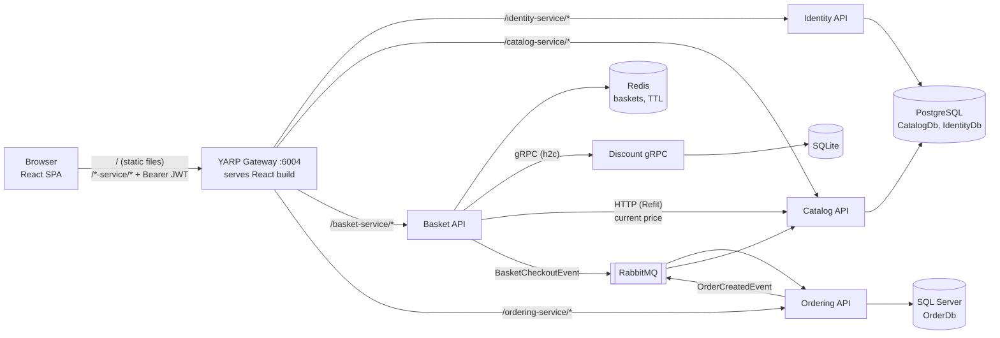

# Microservice Template — `fastTrack-dev2-ecommerce` (simplified)

This is a cut-down version of the CAL.CD.Users + CAL.CD.UserManagement.Web template, adapted for a
**simple e-commerce system** that runs on **Docker / local only**. It builds on the **current
`fastTrack-dev2-ecommerce` repo** (.NET 8, Catalog / Basket / Discount gRPC / Ordering, YARP,
MassTransit + RabbitMQ) and removes **MediatR, Mapster and Marten**.

What changed compared with the original template:

| Original template | This project | Why |
|---|---|---|
| 2 repos (domain service + BFF/MFE) | **1 monorepo** (the current repo), 1 solution, 1 compose | Small team, small system |
| BFF per frontend | **No BFF**. The React app calls services through the gateway | One UI. Add an aggregation endpoint in the gateway only if a screen needs it |
| single-spa micro-frontend + root config | **One React app** (Vite + TypeScript) | No import maps, no SystemJS, no root config |
| webpack 5 | **Vite** | webpack was only needed for single-spa/SystemJS output |
| nginx + self-signed certs | **YARP** gateway, **plain HTTP** locally | YARP also serves the built React files → one origin, no CORS |
| AWS SNS/SQS + LocalStack | **RabbitMQ** via **MassTransit 8** | Already in the repo. Adds the EF Core transactional outbox |
| DynamoDB (codes with TTL) | **Redis** with key expiry | Redis is already in the stack |
| Serilog | Built-in `Microsoft.Extensions.Logging` | One less dependency |
| Optimizely | `Microsoft.FeatureManagement` (already in Ordering) | Free, config-driven |
| Internal JWT + Cognito | **Identity service** (ASP.NET Core Identity) that **issues JWTs**; every service validates them | See section 5 |
| Permission matrix | **Role-based** policies (`Admin`, `Customer`) | Two roles cover a simple shop |
| MediatR + pipeline behaviors (current repo) | **Use-case classes** + FluentValidation auto-validation + `UseHttpLogging` | MediatR 13+ is commercial; plain classes are easier to follow |
| Mapster (current repo) | **Hand-written mappers** (static extension methods) | Explicit, no reflection |
| Marten (current repo: Catalog, Basket) | Catalog → **EF Core + Npgsql**; Basket → **Redis only** | One ORM everywhere |
| Carter minimal APIs (current repo) | **Controllers** | Every endpoint file changes anyway once MediatR goes |
| Hangfire, WireMock, tests, lint | **Dropped** | Out of scope |

---

## Table of contents

1. [System architecture](#1-system-architecture)
2. [Tech stack](#2-tech-stack)
3. [Repository layout](#3-repository-layout)
4. [Service template (Catalog as the example)](#4-service-template-catalog-as-the-example)
5. [Identity service + JWT](#5-identity-service--jwt)
6. [Basket service (Redis only) + Discount gRPC](#6-basket-service-redis-only--discount-grpc)
7. [Ordering service (Clean Architecture without MediatR)](#7-ordering-service-clean-architecture-without-mediatr)
8. [Events with RabbitMQ (MassTransit)](#8-events-with-rabbitmq-masstransit)
9. [API gateway (YARP)](#9-api-gateway-yarp)
10. [Web (React + Vite)](#10-web-react--vite)
11. [Docker](#11-docker)
12. [Conventions](#12-conventions)
13. [Ports and running locally](#13-ports-and-running-locally)
14. [Migrating the current repo, step by step](#14-migrating-the-current-repo-step-by-step)
15. [Checklist](#15-checklist)
16. [Things deliberately left out](#16-things-deliberately-left-out)

---

## 1. System architecture



**How the pieces divide the work**

- **Identity** (new): owns users and roles (ASP.NET Core Identity on Postgres). `register` / `login`
  return a signed **JWT**.
- **Catalog**: products. Public reads, admin writes. Consumes `OrderCreatedEvent` to decrement stock.
- **Discount** (gRPC, internal only — **kept on purpose, it is the project's gRPC example**):
  coupons per product. Basket asks it for the discount on every basket update. Not exposed through
  the gateway.
- **Basket**: one basket per user in **Redis** with a TTL. Gets the current price from Catalog and the
  discount from Discount. `checkout` publishes `BasketCheckoutEvent`.
- **Ordering**: consumes `BasketCheckoutEvent`, creates the order, publishes `OrderCreatedEvent`
  through the outbox. Customers see their orders, admins see all.
- **Gateway (YARP)**: one public port. Routes `/{service}-service/*` to the services and serves the
  React build for every other path. Forwards `Authorization` unchanged.
- **Web (React)**: one SPA, same origin as the gateway.

Each service owns its own database (or Redis keys). Services never read another service's tables.

---

## 2. Tech stack

### Back end

| Concern | Choice | Notes |
|---|---|---|
| Runtime | **.NET 8** (`net8.0`), as in the current repo | .NET 8 support ends **10 Nov 2026**. Moving to .NET 10 later = change the TFM + package majors |
| Package versions | Pin **8.x** for every `Microsoft.*` / `Npgsql.*` package | `dotnet add package X` without `--version 8.*` installs 10.x, which does not support `net8.0` |
| Web | ASP.NET Core **controllers** | Replaces Carter |
| ORM | **EF Core 8** everywhere | Npgsql (Catalog, Identity), SqlServer (Ordering), Sqlite (Discount) |
| Databases | Postgres (`catalogdb` container: `CatalogDb` + `IdentityDb`), SQL Server (`OrderDb`), SQLite (Discount) | As in the current repo, minus the `basketdb` container |
| Cache / key-value | **Redis** via `StackExchange.Redis` | Basket storage. Replaces Marten + `CachedBasketRepository` + Scrutor |
| Sync calls | **gRPC** Basket → Discount (h2c, no TLS); **Refit** Basket → Catalog | |
| Messaging | **RabbitMQ** + **MassTransit 8.x** (pin `8.*`) | MassTransit 9 needs a commercial license |
| Outbox | MassTransit **EF Core outbox** (`UsePostgres()` / `UseSqlServer()`) | Fixes "publish then SaveChanges fails" in the current Ordering code |
| Validation | **FluentValidation 11** + `SharpGrip.FluentValidation.AutoValidation.Mvc` | Replaces `ValidationBehavior` |
| Mapping | Hand-written `ToDto()` / `ToEntity()` extension methods | Replaces Mapster |
| Auth | **ASP.NET Core Identity** (Identity service) + **JWT bearer** (all services) | HS256 shared key locally |
| Logging | Built-in logging + `UseHttpLogging()` | Replaces `LoggingBehavior` |
| Feature flags | `Microsoft.FeatureManagement` | Already used by Ordering |
| Errors | `IExceptionHandler` → RFC 7807 `ProblemDetails` | Shared, replaces `CustomExceptionHandler` |
| API docs | **Swashbuckle** with a Bearer security definition | On each service's own port |
| Health | `AspNetCore.HealthChecks.*` + `HealthChecks.UI.Client` | `/health` (already there) |
| Gateway | **YARP 2.x** | Already there; adds static files + SPA fallback |

> Avoid packages that went commercial: **MediatR 13+**, **AutoMapper 15+**, **MassTransit 9+**,
> **FluentAssertions 7+**.

### Front end

| Concern | Choice | Notes |
|---|---|---|
| Framework | **React 18** + **TypeScript** | |
| Build / dev server | **Vite** | No webpack |
| Routing | `react-router-dom` | |
| Server state | **TanStack Query v5** + plain `fetch` | |
| Client state | React Context (auth only) | |
| Forms | Controlled inputs (or `react-hook-form`) | |
| UI | Plain CSS / CSS Modules (or MUI / Bootstrap) | |
| Auth in UI | JWT in `localStorage`, decoded with `jwt-decode` | Server still enforces everything |
| Package manager | **yarn** (or npm), Node ≥ 20 | |

---

## 3. Repository layout

```text
fastTrack-dev2-ecommerce/
├── README.md
└── src/
    ├── Ecommerce.sln
    ├── docker-compose.yml / docker-compose.override.yml / docker-compose.dcproj
    ├── .env                                   # JWT_SIGNING_KEY (git-ignored)
    ├── Ecommerce.postman_collection.json
    ├── Shared/
    │   ├── Ecommerce.Shared/                  # exceptions + handler, JWT setup, ICurrentUser, Pagination
    │   └── Ecommerce.Shared.Messaging/        # event records + AddMessageBroker (MassTransit)
    ├── Services/
    │   ├── Identity/Ecommerce.Identity.Api/               # NEW
    │   ├── Catalog/Ecommerce.Catalog.Api/                 # Marten → EF Core
    │   ├── Basket/Ecommerce.Basket.Api/                   # Marten → Redis only
    │   ├── Discount/Ecommerce.Discount.Grpc/              # unchanged except Mapster
    │   └── Ordering/
    │       ├── Ecommerce.Ordering.Api/                    # controllers
    │       ├── Ecommerce.Ordering.Application/            # use-case classes (no MediatR)
    │       ├── Ecommerce.Ordering.Domain/
    │       └── Ecommerce.Ordering.Infrastructure/         # EF Core SQL Server + migrations
    ├── ApiGateways/
    │   └── Ecommerce.YarpApiGateway/          # YARP + serves Web build from wwwroot
    └── Web/
        └── ecommerce-web/                     # NEW: React + Vite
```

Catalog, Basket and Identity stay **one project each** with folders. Ordering keeps its four
Clean Architecture projects (they're the course's DDD example); only MediatR is removed.

`Ecommerce.Shared` loses `CQRS/` (`ICommand`, `IQuery`, handlers) and `Behaviors/`
(`ValidationBehavior`, `LoggingBehavior`), and with them the MediatR package reference.

---

## 4. Service template (Catalog as the example)

### 4.1 Folders inside a service

```text
Services/Catalog/Ecommerce.Catalog.Api/
├── Program.cs
├── Dockerfile
├── appsettings.json                 # local defaults (localhost:<port>) — used when run from the IDE
├── Configuration/                   # AppSettings + one class per section
├── Startup/
│   ├── ServiceRegistration.cs       # AddApplicationServices(): all AddScoped<IX, X>()
│   └── DatabaseExtensions.cs        # AddDatabase() + MigrateAndSeedAsync()
├── Presentation/
│   ├── Controllers/                 # thin
│   ├── Models/                      # request/response DTOs
│   ├── Validation/                  # one validator per request model
│   └── Mappers/                     # ProductMapper: ToDto() / ToEntity()
├── ApplicationLogic/                # ProductReader, ProductCreator, ProductUpdater, ProductDeleter
├── Models/                          # entities (Product) — folder name kept from the current repo
├── Data/
│   ├── CatalogDbContext.cs
│   ├── Configurations/              # IEntityTypeConfiguration<T>
│   ├── Migrations/                  # generated by dotnet ef
│   ├── CatalogInitialData.cs        # seed (was a Marten IInitialData)
│   └── ProductRepository.cs
└── Consumers/                       # OrderCreatedEventConsumer
```

The current vertical-slice folders (`Products/CreateProduct/...`) are fine too if you prefer them.
What matters is: endpoint → use-case class → repository, no MediatR in between.

**Naming conventions**

| Kind | Pattern | Example |
|---|---|---|
| Use case | `{Entity}{Verb}er` + `I{Entity}{Verb}er` | `ProductCreator`, `IProductReader` |
| Repository | `{Entity}Repository` | `ProductRepository : IProductRepository` |
| Mapper | `{Entity}Mapper` static class with `ToDto` / `ToEntity` | `ProductMapper` |
| Validator | `{Model}Validator` | `CreateProductRequestValidator` |
| EF config | `{Entity}Configuration` | `ProductConfiguration` |
| Integration event | `{Thing}{Happened}Event` record (current repo style) | `BasketCheckoutEvent`, `OrderCreatedEvent` |
| Consumer | `{Event}Consumer` | `BasketCheckoutEventConsumer` |
| Settings section | `{Name}Settings` | `JwtSettings`, `GrpcSettings` |

### 4.2 Request flow

```text
Browser → YARP (/catalog-service/*) → Catalog :8080
  → UseExceptionHandler → UseHttpLogging → UseAuthentication → UseAuthorization
  → [ApiController] model binding + FluentValidation (400 ValidationProblemDetails)
  → Controller        (map DTO → entity, call use case, map back)
  → ApplicationLogic  (business rules, throws NotFoundException / BadRequestException ...)
  → Repository        (EF Core)
  → IPublishEndpoint  (event written to the outbox in the same SaveChanges)
  ← GlobalExceptionHandler → ProblemDetails
```

### 4.3 `Program.cs`

```csharp
var builder = WebApplication.CreateBuilder(args);

// 1. Settings
var appSettings = builder.Configuration.Get<AppSettings>()!;
builder.Services.AddOptions<AppSettings>().Bind(builder.Configuration)
    .ValidateDataAnnotations().ValidateOnStart();
builder.Services.AddSingleton(appSettings);
builder.Services.AddSingleton(appSettings.Jwt);

// 2. Cross-cutting
builder.Services.AddHttpLogging(_ => { });
builder.Services.AddProblemDetails();
builder.Services.AddExceptionHandler<GlobalExceptionHandler>();   // Ecommerce.Shared
builder.Services.AddJwtAuth(appSettings.Jwt);                       // Ecommerce.Shared, see 5.3

// 3. Infrastructure
var connectionString = builder.Configuration.GetConnectionString("Database")!;
builder.Services.AddDbContext<CatalogDbContext>(o => o.UseNpgsql(connectionString));
builder.Services.AddMessageBroker(builder.Configuration, typeof(Program).Assembly,
    outbox => outbox.UsePostgres<CatalogDbContext>());             // see 8.2
builder.Services.AddHealthChecks().AddNpgSql(connectionString);

// 4. Application
builder.Services.AddApplicationServices();

// 5. MVC + validation + docs
builder.Services.AddControllers();
builder.Services.AddValidatorsFromAssemblyContaining<Program>();
builder.Services.AddFluentValidationAutoValidation();
builder.Services.AddEndpointsApiExplorer();
builder.Services.AddSwaggerWithBearer();

var app = builder.Build();

app.UseExceptionHandler();
app.UseHttpLogging();
if (app.Environment.IsDevelopment())
{
    app.UseSwagger();
    app.UseSwaggerUI();
    await app.MigrateAndSeedAsync();      // dev only: apply migrations + seed
}
app.UseAuthentication();
app.UseAuthorization();
app.MapControllers();
app.MapHealthChecks("/health", new HealthCheckOptions
    { ResponseWriter = UIResponseWriter.WriteHealthCheckUIResponse }).AllowAnonymous();

app.Run();
```

### 4.4 Configuration

Keep the current repo's keys (`ConnectionStrings:Database`, `MessageBroker:*`, `GrpcSettings:*`) and
add a `Jwt` section. Values in `appsettings.json` point to `localhost` (IDE runs); compose overrides
them with env vars (`ConnectionStrings__Database=...`), as it does today.

```csharp
public class AppSettings
{
    [Required] public JwtSettings Jwt { get; set; } = default!;
}

// Ecommerce.Shared/Auth/JwtSettings.cs — every service needs it
public class JwtSettings
{
    [Required] public string Issuer { get; set; } = default!;
    [Required] public string Audience { get; set; } = default!;
    [Required, MinLength(32)] public string SigningKey { get; set; } = default!;
    public int ExpiryMinutes { get; set; } = 120;
}
```

```json
{
  "ConnectionStrings": {
    "Database": "Server=localhost;Port=5432;Database=CatalogDb;User Id=postgres;Password=postgres;Include Error Detail=true"
  },
  "MessageBroker": { "Host": "amqp://localhost:5672", "UserName": "guest", "Password": "guest" },
  "Jwt": { "Issuer": "ecommerce-identity", "Audience": "ecommerce",
           "SigningKey": "local-dev-only-signing-key-change-me-0123456789" }
}
```

### 4.5 Entity, DbContext, configuration (Catalog: Marten → EF Core)

The Marten document `Product` maps to EF Core almost unchanged. `List<string> Category` becomes a
Postgres `text[]` column (EF Core 8 primitive collections), and `Contains` still works in queries.

```csharp
public class Product
{
    public Guid Id { get; set; }
    public string Name { get; set; } = default!;
    public List<string> Category { get; set; } = new();
    public string Description { get; set; } = default!;
    public string ImageFile { get; set; } = default!;
    public decimal Price { get; set; }
    public int Stock { get; set; }                     // new: decremented by OrderCreatedEvent
}

public class CatalogDbContext(DbContextOptions<CatalogDbContext> options) : DbContext(options)
{
    public DbSet<Product> Products => Set<Product>();

    protected override void OnModelCreating(ModelBuilder modelBuilder)
    {
        modelBuilder.ApplyConfigurationsFromAssembly(typeof(CatalogDbContext).Assembly);

        // MassTransit outbox/inbox tables (section 8)
        modelBuilder.AddInboxStateEntity();
        modelBuilder.AddOutboxMessageEntity();
        modelBuilder.AddOutboxStateEntity();
    }
}

public class ProductConfiguration : IEntityTypeConfiguration<Product>
{
    public void Configure(EntityTypeBuilder<Product> builder)
    {
        builder.ToTable("Products");
        builder.HasKey(x => x.Id);
        builder.Property(x => x.Name).HasMaxLength(200).IsRequired();
        builder.Property(x => x.Price).HasPrecision(18, 2);
        builder.HasIndex(x => x.Category).HasMethod("gin");   // fast "category contains"
    }
}

public static async Task MigrateAndSeedAsync(this WebApplication app)
{
    using var scope = app.Services.CreateScope();
    var db = scope.ServiceProvider.GetRequiredService<CatalogDbContext>();
    await db.Database.MigrateAsync();          // also creates the database if it doesn't exist
    if (!await db.Products.AnyAsync())
    {
        db.Products.AddRange(CatalogInitialData.Products);
        await db.SaveChangesAsync();
    }
}
```

### 4.6 Repository

```csharp
public class ProductRepository(CatalogDbContext db) : IProductRepository
{
    public Task<Product?> GetById(Guid id) =>
        db.Products.AsNoTracking().SingleOrDefaultAsync(p => p.Id == id);

    public async Task<PaginatedResult<Product>> Search(ProductQuery q)
    {
        var query = db.Products.AsNoTracking().AsQueryable();
        if (!string.IsNullOrWhiteSpace(q.Category)) query = query.Where(p => p.Category.Contains(q.Category));
        if (!string.IsNullOrWhiteSpace(q.Search))   query = query.Where(p => EF.Functions.ILike(p.Name, $"%{q.Search}%"));

        var total = await query.LongCountAsync();
        var items = await query.OrderBy(p => p.Name)
            .Skip(q.PageIndex * q.PageSize).Take(q.PageSize).ToListAsync();
        return new PaginatedResult<Product>(q.PageIndex, q.PageSize, total, items);
    }

    public Task<Product?> GetForUpdate(Guid id) => db.Products.SingleOrDefaultAsync(p => p.Id == id);
    public void Add(Product p) => db.Products.Add(p);
    public void Remove(Product p) => db.Products.Remove(p);
    public Task SaveChanges() => db.SaveChangesAsync();
}
```

`PaginatedResult<T>` and `PaginationRequest` already exist in `Ecommerce.Shared/Pagination`.

### 4.7 Use case (replaces a MediatR handler)

Before (current repo): `CreateProductCommand` + `CreateProductCommandHandler : ICommandHandler<...>`
+ `CreateProductEndpoint` calling `sender.Send(command)`.

After:

```csharp
public interface IProductCreator { Task<Product> Create(Product product); }

public class ProductCreator(IProductRepository repository) : IProductCreator
{
    public async Task<Product> Create(Product product)
    {
        product.Id = Guid.NewGuid();
        repository.Add(product);
        await repository.SaveChanges();
        return product;
    }
}

// Startup/ServiceRegistration.cs
public static IServiceCollection AddApplicationServices(this IServiceCollection services) => services
    .AddScoped<IProductRepository, ProductRepository>()
    .AddScoped<IProductReader, ProductReader>()
    .AddScoped<IProductCreator, ProductCreator>()
    .AddScoped<IProductUpdater, ProductUpdater>()
    .AddScoped<IProductDeleter, ProductDeleter>();
```

The `Command`/`Query` records disappear; the controller passes the request DTO (mapped to an entity)
straight to the use case.

### 4.8 Errors (shared)

The current `Ecommerce.Shared/Exceptions` (`NotFoundException`, `BadRequestException`,
`InternalServerException`) stay. Replace `CustomExceptionHandler` with one that also understands auth
errors and doesn't leak stack traces:

```csharp
public class ForbiddenException(string message) : Exception(message);

public class GlobalExceptionHandler(IProblemDetailsService problemDetails, ILogger<GlobalExceptionHandler> log)
    : IExceptionHandler
{
    public async ValueTask<bool> TryHandleAsync(HttpContext ctx, Exception ex, CancellationToken ct)
    {
        var status = ex switch
        {
            NotFoundException         => 404,
            BadRequestException       => 400,
            UnauthorizedAccessException => 401,
            ForbiddenException        => 403,
            _                         => 500,
        };

        var errorId = Guid.NewGuid().ToString("N")[..8];
        if (status == 500) log.LogError(ex, "Unhandled error {ErrorId}", errorId);

        ctx.Response.StatusCode = status;
        return await problemDetails.TryWriteAsync(new ProblemDetailsContext
        {
            HttpContext = ctx,
            ProblemDetails =
            {
                Status = status,
                Title = status == 500 ? "An unexpected error occurred." : ex.Message,
                Extensions = { ["errorId"] = errorId }
            }
        });
    }
}
```

Validation errors use the built-in `ValidationProblemDetails` (`errors: { field: [messages] }`).

### 4.9 Validation

```csharp
public class CreateProductRequestValidator : AbstractValidator<CreateProductRequest>
{
    public CreateProductRequestValidator()
    {
        RuleFor(x => x.Name).NotEmpty().MaximumLength(200);
        RuleFor(x => x.Category).NotEmpty();
        RuleFor(x => x.ImageFile).NotEmpty();
        RuleFor(x => x.Price).GreaterThan(0);
    }
}
```

Validators move from the `Command` records to the request DTOs. `AddFluentValidationAutoValidation()`
runs them before the action — the job `ValidationBehavior` did in the MediatR pipeline.

### 4.10 Mapper (replaces Mapster)

```csharp
public static class ProductMapper
{
    public static ProductDto ToDto(this Product p) =>
        new(p.Id, p.Name, p.Category, p.Description, p.ImageFile, p.Price, p.Stock);

    public static Product ToEntity(this CreateProductRequest r) => new()
    {
        Name = r.Name, Category = r.Category, Description = r.Description,
        ImageFile = r.ImageFile, Price = r.Price, Stock = r.Stock,
    };
}
```

Find every `.Adapt<` call (Catalog, Basket, Discount, Ordering) and replace it with a method like
these. The compiler then tells you when a new property isn't mapped, which Mapster never did.

### 4.11 Controller (replaces Carter modules)

```csharp
[ApiController]
[Route("products")]
public class ProductsController(
    IProductReader reader, IProductCreator creator, IProductUpdater updater,
    IProductDeleter deleter) : ControllerBase
{
    [HttpGet, AllowAnonymous]
    public async Task<ActionResult<PaginatedResult<ProductDto>>> Search([FromQuery] ProductQuery q)
        => Ok((await reader.Search(q)).Map(p => p.ToDto()));

    [HttpGet("{id:guid}"), AllowAnonymous]
    public async Task<ActionResult<ProductDto>> GetById(Guid id)
        => Ok((await reader.GetById(id)).ToDto());          // reader throws ProductNotFoundException

    [HttpPost, Authorize(Policy = Policies.Admin)]
    public async Task<ActionResult<ProductDto>> Create(CreateProductRequest request)
    {
        var created = await creator.Create(request.ToEntity());
        return CreatedAtAction(nameof(GetById), new { id = created.Id }, created.ToDto());
    }

    [HttpPut("{id:guid}"), Authorize(Policy = Policies.Admin)]
    public async Task<IActionResult> Update(Guid id, UpdateProductRequest request)
    {
        await updater.Update(id, request);
        return NoContent();
    }

    [HttpDelete("{id:guid}"), Authorize(Policy = Policies.Admin)]
    public async Task<IActionResult> Delete(Guid id)
    {
        await deleter.Delete(id);
        return NoContent();
    }
}
```

Keep the current public URLs where possible (`/products`, `/products/{id}`,
`/products/category/{category}`) so the Postman collection keeps working; only `POST`/`PUT` bodies
change from `{ ... }` command shapes to request DTOs (same fields).

### 4.12 Swagger, health

- Swagger UI on each service port in Development (`http://localhost:6000/swagger`), Bearer
  security definition so you can paste a token from `/identity-service/auth/login`.
- `/health` on every service, anonymous (already present; add `.AllowAnonymous()` because of the
  fallback auth policy).

### 4.13 Migrations

```bash
# from src/
dotnet ef migrations add InitialCreate --project Services/Catalog/Ecommerce.Catalog.Api --output-dir Data/Migrations
dotnet ef migrations add InitialCreate --project Services/Identity/Ecommerce.Identity.Api --output-dir Data/Migrations
dotnet ef migrations add Simplify --project Services/Ordering/Ecommerce.Ordering.Infrastructure \
  --startup-project Services/Ordering/Ecommerce.Ordering.Api --output-dir Data/Migrations
```

Install `dotnet-ef` **8.x** (`dotnet tool install -g dotnet-ef --version 8.*`). Services apply
migrations at startup in Development (Ordering and Discount already do). Reset everything with
`docker compose down -v`.

---

## 5. Identity service + JWT

### 5.1 Which one: Identity or JWT?

They are not alternatives. **ASP.NET Core Identity** stores users, hashes passwords and manages roles.
**JWT** is the token the browser sends to every service. The simplest setup across microservices:

> **Identity service = ASP.NET Core Identity (user store) + issues a JWT. Every other service only
> validates the JWT** (shared HS256 key). Roles travel inside the token as `role` claims.

| Option | Problem |
|---|---|
| Identity's built-in `MapIdentityApi()` bearer tokens | Opaque tokens (Data Protection), not JWT. Other services can't validate them |
| Cookies | Same cookie domain + shared Data Protection keys in every service, plus CSRF |
| Keycloak / Duende / OpenIddict | Right for production, but an extra system to learn and run |
| Hand-written `Users` table + `PasswordHasher<T>` | Works, but you rebuild unique email, lockout, roles… |

### 5.2 Identity service

```text
Services/Identity/Ecommerce.Identity.Api/
├── Program.cs  Dockerfile  appsettings.json
├── Presentation/Controllers/AuthController.cs     # register, login, me
├── Presentation/Models/                           # RegisterRequest, LoginRequest, AuthResponse
├── ApplicationLogic/TokenIssuer.cs
└── Data/AppIdentityDbContext.cs  Migrations/  IdentitySeed.cs   # roles + admin user
```

Database: **`IdentityDb` on the existing `catalogdb` Postgres container**
(`Server=catalogdb;Port=5432;Database=IdentityDb;...`). `MigrateAsync()` creates the database, so no
init script or extra container is needed.

```csharp
public class AppUser : IdentityUser<Guid>
{
    public string FirstName { get; set; } = "";
    public string LastName { get; set; } = "";
}

public class AppIdentityDbContext(DbContextOptions<AppIdentityDbContext> o)
    : IdentityDbContext<AppUser, IdentityRole<Guid>, Guid>(o);

// Program.cs
builder.Services.AddDbContext<AppIdentityDbContext>(o =>
    o.UseNpgsql(builder.Configuration.GetConnectionString("Database")));
builder.Services.AddIdentityCore<AppUser>(o =>
    {
        o.User.RequireUniqueEmail = true;
        o.Password.RequireNonAlphanumeric = false;   // dev-friendly
        o.Password.RequiredLength = 6;
    })
    .AddRoles<IdentityRole<Guid>>()
    .AddEntityFrameworkStores<AppIdentityDbContext>();
builder.Services.AddScoped<ITokenIssuer, TokenIssuer>();
builder.Services.AddJwtAuth(appSettings.Jwt);
```

```csharp
public class TokenIssuer(JwtSettings s) : ITokenIssuer
{
    public string Issue(AppUser user, IList<string> roles)
    {
        var claims = new List<Claim>
        {
            new(JwtRegisteredClaimNames.Sub, user.Id.ToString()),
            new(JwtRegisteredClaimNames.Email, user.Email!),
            new("name", $"{user.FirstName} {user.LastName}".Trim()),
        };
        claims.AddRange(roles.Select(r => new Claim("role", r)));

        var key = new SymmetricSecurityKey(Encoding.UTF8.GetBytes(s.SigningKey));
        var token = new JwtSecurityToken(s.Issuer, s.Audience, claims,
            expires: DateTime.UtcNow.AddMinutes(s.ExpiryMinutes),
            signingCredentials: new SigningCredentials(key, SecurityAlgorithms.HmacSha256));
        return new JwtSecurityTokenHandler().WriteToken(token);
    }
}

[ApiController, Route("auth")]
public class AuthController(UserManager<AppUser> users, ITokenIssuer tokens) : ControllerBase
{
    [HttpPost("register"), AllowAnonymous]
    public async Task<ActionResult<AuthResponse>> Register(RegisterRequest r)
    {
        var user = new AppUser { Id = Guid.NewGuid(), UserName = r.Email, Email = r.Email,
                                 FirstName = r.FirstName, LastName = r.LastName };
        var result = await users.CreateAsync(user, r.Password);
        if (!result.Succeeded)
            throw new BadRequestException(string.Join(" ", result.Errors.Select(e => e.Description)));
        await users.AddToRoleAsync(user, Roles.Customer);
        return Ok(new AuthResponse(tokens.Issue(user, [Roles.Customer])));
    }

    [HttpPost("login"), AllowAnonymous]
    public async Task<ActionResult<AuthResponse>> Login(LoginRequest r)
    {
        var user = await users.FindByEmailAsync(r.Email);
        if (user is null || !await users.CheckPasswordAsync(user, r.Password))
            throw new UnauthorizedAccessException("Invalid email or password.");
        return Ok(new AuthResponse(tokens.Issue(user, await users.GetRolesAsync(user))));
    }
}
```

Seed on startup: roles `Admin`, `Customer`, and one admin (`admin@shop.local` / `Admin123`). No
refresh tokens: the token lasts 2 hours, and the UI sends the user back to login on 401.

### 5.3 JWT validation (shared, used by every HTTP service)

```csharp
// Ecommerce.Shared/Auth/AuthExtensions.cs
// csproj needs: <FrameworkReference Include="Microsoft.AspNetCore.App" />
//               Microsoft.AspNetCore.Authentication.JwtBearer 8.*
public static class Roles    { public const string Admin = "Admin", Customer = "Customer"; }
public static class Policies { public const string Admin = "Admin", Customer = "Customer"; }

public static IServiceCollection AddJwtAuth(this IServiceCollection services, JwtSettings s)
{
    services.AddAuthentication(JwtBearerDefaults.AuthenticationScheme)
        .AddJwtBearer(o =>
        {
            o.MapInboundClaims = false;                  // keep "sub", "role" as-is
            o.TokenValidationParameters = new TokenValidationParameters
            {
                ValidIssuer = s.Issuer,
                ValidAudience = s.Audience,
                IssuerSigningKey = new SymmetricSecurityKey(Encoding.UTF8.GetBytes(s.SigningKey)),
                NameClaimType = "name",
                RoleClaimType = "role",
            };
        });

    services.AddAuthorizationBuilder()
        .AddPolicy(Policies.Admin, p => p.RequireRole(Roles.Admin))
        .AddPolicy(Policies.Customer, p => p.RequireRole(Roles.Customer, Roles.Admin))
        .SetFallbackPolicy(new AuthorizationPolicyBuilder().RequireAuthenticatedUser().Build());

    services.AddHttpContextAccessor();
    services.AddScoped<ICurrentUser, CurrentUser>();
    return services;
}

public interface ICurrentUser { Guid UserId { get; } string Email { get; } string Name { get; } bool IsAdmin { get; } }
public class CurrentUser(IHttpContextAccessor http) : ICurrentUser
{
    private ClaimsPrincipal User => http.HttpContext!.User;
    public Guid UserId => Guid.Parse(User.FindFirstValue("sub")!);
    public string Email => User.FindFirstValue("email")!;
    public string Name => User.FindFirstValue("name") ?? Email;
    public bool IsAdmin => User.IsInRole(Roles.Admin);
}
```

Discount (gRPC) is internal and not routed by the gateway, so it doesn't need JWT.

**Permission rules**

| Action | Rule |
|---|---|
| Browse products | Anonymous |
| Basket (get / store / delete / checkout) | `Customer`; basket key = `ICurrentUser.UserId` (never from the URL) |
| My orders | `Customer`; filtered by `CustomerId == UserId` |
| All orders, update / delete order | `Admin` |
| Create / update / delete products | `Admin` |

The signing key comes from `.env` (`JWT_SIGNING_KEY`, ≥ 32 chars) and reaches every service as
`Jwt__SigningKey`.

---

## 6. Basket service (Redis only) + Discount gRPC

### 6.1 Storage: Marten + Redis cache → Redis only

The current Basket stores the cart in Postgres with Marten and caches it in Redis
(`CachedBasketRepository` via Scrutor's `Decorate`). A basket is temporary data, so **Redis alone is
enough**. That's also the DynamoDB replacement from the original template (key-value + TTL).

Removed: Marten, Scrutor, `CachedBasketRepository`, the `basketdb` container and its volume.

```csharp
public class BasketRepository(IConnectionMultiplexer redis) : IBasketRepository
{
    private static readonly TimeSpan Ttl = TimeSpan.FromDays(30);
    private readonly IDatabase _db = redis.GetDatabase();
    private static string Key(Guid userId) => $"basket:{userId}";

    public async Task<ShoppingCart> Get(Guid userId)
    {
        var json = await _db.StringGetAsync(Key(userId));
        return json.IsNullOrEmpty ? new ShoppingCart(userId) : JsonSerializer.Deserialize<ShoppingCart>(json!)!;
    }

    public Task Save(ShoppingCart cart) =>
        _db.StringSetAsync(Key(cart.UserId), JsonSerializer.Serialize(cart), Ttl);   // TTL refreshed on write

    public Task Delete(Guid userId) => _db.KeyDeleteAsync(Key(userId));
}

// Program.cs
builder.Services.AddSingleton<IConnectionMultiplexer>(
    _ => ConnectionMultiplexer.Connect(builder.Configuration.GetConnectionString("Redis")!));
```

`ShoppingCart` is keyed by **`UserId` (Guid from the token)** instead of `UserName` from the URL.
Routes become `GET /basket`, `POST /basket`, `DELETE /basket`, `POST /basket/checkout`, all for the
current user.

### 6.2 Prices: Catalog (Refit) + Discount (gRPC)

**Bug in the current code:** `StoreBasketHandler` does `item.Price -= coupon.Amount` on the price
**sent by the client**. `GET /basket` then returns the discounted price; when the UI adds another
item and posts the whole cart back, the discount is subtracted **again** (and the price can go
negative). The client can also send any price it likes.

Fix: the client sends only `ProductId` + `Quantity`. Basket recomputes every line on each store,
from Catalog's price and Discount's coupon, and keeps the original price and the discount apart:

```csharp
public class ShoppingCartItem
{
    public Guid ProductId { get; set; }
    public string ProductName { get; set; } = default!;
    public int Quantity { get; set; }
    public decimal UnitPrice { get; set; }        // from Catalog
    public decimal Discount { get; set; }         // from Discount gRPC
    public decimal Price => Math.Max(0, UnitPrice - Discount);
}

public async Task<ShoppingCart> Store(Guid userId, List<StoreBasketItem> items)   // items = (ProductId, Quantity)
{
    var cart = new ShoppingCart(userId);
    foreach (var i in items)
    {
        var product = await catalog.GetProduct(i.ProductId);                            // HTTP (Refit)
        var coupon  = await discount.GetDiscountAsync(
            new GetDiscountRequest { ProductName = product.Name });                    // gRPC
        cart.Items.Add(new ShoppingCartItem
        {
            ProductId = product.Id, ProductName = product.Name, Quantity = i.Quantity,
            UnitPrice = product.Price, Discount = coupon.Amount,
        });
    }
    await repository.Save(cart);
    return cart;
}
```

```csharp
public interface ICatalogClient { [Get("/products/{id}")] Task<CatalogProduct> GetProduct(Guid id); }

builder.Services.AddRefitClient<ICatalogClient>()
    .ConfigureHttpClient(c => c.BaseAddress = new Uri(builder.Configuration["CatalogSettings:Url"]!)) // http://ecommerce.catalog.api:8080
    .AddStandardResilienceHandler();
```

> Coupons are matched by **product name** (`discount.proto` has `productName`). That's fine for the
> course, but renaming a product in Catalog silently drops its discount. If that matters, add a
> `productId` field to the proto (new field number, keep `productName` for compatibility).

### 6.3 Discount gRPC without HTTPS

Discount's Kestrel already sets `"Protocols": "Http2"`, so it can serve **gRPC over plain HTTP/2
(h2c)**. Basket then calls it with `http://` and the `DangerousAcceptAnyServerCertificateValidator`
handler goes away:

```csharp
builder.Services.AddGrpcClient<DiscountProtoService.DiscountProtoServiceClient>(o =>
    o.Address = new Uri(builder.Configuration["GrpcSettings:DiscountUrl"]!));   // http://ecommerce.discount.grpc:8080
```

Changes inside Discount:

- Replace the five `.Adapt<CouponModel>()` / `.Adapt<Coupon>()` calls with a `CouponMapper`.
- Fix `UseMigration()`: it calls `dbContext.Database.MigrateAsync()` **without `await`** and
  then disposes the context, so the SQLite table may not exist yet when the first request
  arrives. Use `dbContext.Database.Migrate();`.
- Keep `MapGrpcService<DiscountService>()` and the proto as they are; no JWT (internal service).

> Because the endpoint is HTTP/2 only, a browser or plain `curl` can't call it. Use
> `grpcurl -plaintext localhost:6002 list` or Postman's gRPC tab.

### 6.4 Checkout

```csharp
public async Task Checkout(CheckoutRequest r)
{
    var cart = await repository.Get(currentUser.UserId);
    if (cart.Items.Count == 0) throw new BadRequestException("Basket is empty.");

    await publisher.Publish(new BasketCheckoutEvent
    {
        CustomerId = currentUser.UserId,
        UserName = currentUser.Name,
        EmailAddress = currentUser.Email,
        TotalPrice = cart.TotalPrice,
        Items = cart.Items.Select(i => new BasketCheckoutItem(i.ProductId, i.ProductName, i.Price, i.Quantity)).ToList(),
        FirstName = r.FirstName, LastName = r.LastName, AddressLine = r.AddressLine,
        Country = r.Country, State = r.State, ZipCode = r.ZipCode,
        PaymentMethod = r.PaymentMethod,          // CashOnDelivery | FakeCard — no card data (7.4)
    });

    await repository.Delete(currentUser.UserId);
}
```

Basket has no relational DB, so it can't use the EF outbox. It publishes directly: if RabbitMQ is
down the call fails, the basket stays, and the user can retry. Ordering ignores duplicates by event
`Id` (section 8.3).

---

## 7. Ordering service (Clean Architecture without MediatR)

The four projects stay. What changes inside them:

| Layer | Now | After |
|---|---|---|
| Api | Carter `Endpoints/*.cs` → `sender.Send(...)` | `Controllers/OrdersController.cs` → use-case interfaces |
| Application | `Commands/*`, `Queries/*` (MediatR handlers), `EventHandlers/Domain/*` (`INotificationHandler`) | `Orders/OrderCreator.cs`, `OrderUpdater.cs`, `OrderDeleter.cs`, `OrderReader.cs` + interfaces; `Consumers/BasketCheckoutEventConsumer.cs` |
| Domain | `IDomainEvent : INotification`, `Aggregate` keeps a domain-event list | Remove `IDomainEvent`, `OrderCreatedEvent`/`OrderUpdatedEvent` domain events and the list in `Aggregate` (the rest of the DDD model — value objects, `Order.Create`, `Order.Add`, … — stays) |
| Infrastructure | `DispatchDomainEventsInterceptor(IMediator)` publishes during `SaveChanges` | **Delete it.** Keep `AuditableEntityInterceptor` (use `ICurrentUser` for `CreatedBy`). Add MassTransit outbox tables |

### 7.1 Use case publishes the integration event through the outbox

```csharp
public class OrderCreator(IApplicationDbContext db, IPublishEndpoint publisher,
                          IFeatureManager features, IPaymentGateway payments) : IOrderCreator
{
    public async Task<Guid> CreateFromCheckout(BasketCheckoutEvent e)
    {
        await EnsureCustomer(e);                                   // see 7.2

        var address = Address.Of(e.FirstName, e.LastName, e.EmailAddress, e.AddressLine, e.Country, e.State, e.ZipCode);
        var order = Order.Create(OrderId.Of(Guid.NewGuid()), CustomerId.Of(e.CustomerId),
            OrderName.Of(e.UserName), address, address, (PaymentMethod)e.PaymentMethod);

        foreach (var i in e.Items)
            order.Add(ProductId.Of(i.ProductId), i.ProductName, i.Quantity, i.Price);

        if (order.PaymentMethod == PaymentMethod.FakeCard)         // see 7.4
        {
            var result = await payments.Charge(order.Id.Value, order.TotalPrice);
            if (result.Succeeded) order.MarkPaid(result.TransactionId!);
            else order.MarkPaymentFailed();
        }

        db.Orders.Add(order);

        if (await features.IsEnabledAsync("OrderFullfilment"))
            await publisher.Publish(order.ToOrderCreatedEvent());  // written to the outbox, not sent yet

        await db.SaveChangesAsync();                               // order + outbox row in one transaction
        return order.Id.Value;
    }
}
```

Why this matters: today the domain-event interceptor calls `Publish` **inside `SavingChanges`**,
before the order is committed. If the insert fails, the event is already out. With the outbox, the
event is sent only after the commit.

### 7.2 Fix the foreign keys to `Customers` and `Products`

Ordering has `Customers` and `Products` tables (seeded with course data), with FKs from `Orders` and
`OrderItems`. Users created in Identity and products created in Catalog **don't exist there**, so
the first real order fails with an FK violation.

- **Customers**: the consumer upserts a `Customer(Id = e.CustomerId, Name, Email)` before creating
  the order (`EnsureCustomer` above).
- **Products**: drop the `Products` table and the FK from `OrderItems`. Store a snapshot on the line
  instead (`ProductId`, `ProductName`, `Price`). An order must keep the price it was bought at, even
  after the catalog changes.

### 7.3 Payment: how it works today

There is **no real payment** in the current code. The checkout flow only copies card data around:

```text
UI → POST /basket/checkout { userName, customerId, address…, cardName, cardNumber, expiration, cvv, paymentMethod }
   → Basket: load basket, Mapster DTO → BasketCheckoutEvent, set TotalPrice, publish to RabbitMQ, delete basket
   → Ordering consumer: build CreateOrderCommand (items hard-coded!), Payment.Of(cardName, cardNumber, expiration, cvv)
   → Orders row saved with Status = Pending, card number + CVV in plain columns
   → (flag OrderFullfilment on) OrderDto — card data included — published to RabbitMQ, nobody consumes it
```

Nothing charges the card, nothing moves the order out of `Pending` except an admin `PUT /orders`,
and `BasketCheckoutEvent.TotalPrice` doesn't match the order total (the items are hard-coded).
Meanwhile the full card number and CVV travel through RabbitMQ and sit in SQL Server.

### 7.4 Payment: recommended simple flow (simulated)

Keep it a demo, but a consistent one: **no card data ever leaves the browser**, and the order has a
real payment status.

| `PaymentMethod` | What happens in Ordering |
|---|---|
| `CashOnDelivery` | Order created as `Pending`; admin later marks it `Shipped` → `Completed` |
| `FakeCard` | Consumer calls `IPaymentGateway.Charge(orderId, total)` right after creating the order → `Paid` or `PaymentFailed` |

```csharp
public enum OrderStatus { Pending = 1, Paid = 2, PaymentFailed = 3, Shipped = 4, Completed = 5, Cancelled = 6 }

public interface IPaymentGateway { Task<PaymentResult> Charge(Guid orderId, decimal amount); }
public record PaymentResult(bool Succeeded, string? TransactionId, string? Error);

// Infrastructure/Payments/FakePaymentGateway.cs — approves everything below a limit
public class FakePaymentGateway(ILogger<FakePaymentGateway> log) : IPaymentGateway
{
    public Task<PaymentResult> Charge(Guid orderId, decimal amount)
    {
        var ok = amount <= 5_000m;      // easy way to demo a failed payment: order something expensive
        log.LogInformation("Fake charge {OrderId} {Amount}: {Result}", orderId, amount, ok ? "approved" : "declined");
        return Task.FromResult(ok
            ? new PaymentResult(true, $"FAKE-{Guid.NewGuid():N}"[..13], null)
            : new PaymentResult(false, null, "Declined by fake gateway"));
    }
}
```

In the domain, `Payment` becomes `Payment.Of(PaymentMethod method, string? transactionId)`, and `Order`
gets `MarkPaid(transactionId)`, `MarkPaymentFailed()`, `Ship()`, `Complete()`, `Cancel()` with
simple state checks (e.g. only `Paid` or `Pending` + `CashOnDelivery` can be shipped).

The checkout request from the UI is now just: shipping address + `paymentMethod`. The checkout page
can show a fake card form for the look, but never sends its values.

**Stock** is decremented by Catalog when it receives `OrderCreatedEvent` (section 8). If you want
stock taken only for paid orders, publish the event after `MarkPaid` instead.

When you later want real payments, swap `FakePaymentGateway` for **Stripe Checkout in test mode**:
the browser is redirected to Stripe, Stripe calls a webhook on Ordering, and the webhook calls
`MarkPaid`. Card data still never touches your services.

---

## 8. Events with RabbitMQ (MassTransit)

### 8.1 Event contracts (`Ecommerce.Shared.Messaging/Events`)

First fix the base record. Today `Id` and `OccurredOn` are expression-bodied properties
(`=> Guid.NewGuid()`), so they return a **new value on every read**, which makes de-duplication
impossible:

```csharp
public record IntegrationEvent
{
    public Guid Id { get; init; } = Guid.NewGuid();
    public DateTime OccurredOnUtc { get; init; } = DateTime.UtcNow;
}

public record BasketCheckoutEvent : IntegrationEvent
{
    public Guid CustomerId { get; init; }
    public string UserName { get; init; } = default!;
    public decimal TotalPrice { get; init; }
    public List<BasketCheckoutItem> Items { get; init; } = [];     // new: today Ordering hard-codes two products
    // address
    public string FirstName { get; init; } = default!;
    public string LastName { get; init; } = default!;
    public string EmailAddress { get; init; } = default!;
    public string AddressLine { get; init; } = default!;
    public string Country { get; init; } = default!;
    public string State { get; init; } = default!;
    public string ZipCode { get; init; } = default!;
    // payment: method only, never card data (section 7.4)
    public int PaymentMethod { get; init; }                         // 1 = CashOnDelivery, 2 = FakeCard
}
public record BasketCheckoutItem(Guid ProductId, string ProductName, decimal Price, int Quantity);

public record OrderCreatedEvent(Guid OrderId, Guid CustomerId, List<OrderCreatedItem> Items) : IntegrationEvent;
public record OrderCreatedItem(Guid ProductId, int Quantity);
```

| Event | Publisher | Consumer | What the consumer does |
|---|---|---|---|
| `BasketCheckoutEvent` | Basket (direct) | Ordering | Upserts customer, creates order |
| `OrderCreatedEvent` | Ordering (outbox, behind `OrderFullfilment` flag) | Catalog | Decrements `Stock` |

Today the integration event published by Ordering is `OrderDto` itself. Use a dedicated
`OrderCreatedEvent` record so the API DTO and the message contract can change independently.

### 8.2 MassTransit setup (shared extension)

Extend the current `AddMessageBroker` with an optional outbox callback, because Catalog uses
Postgres and Ordering uses SQL Server:

```csharp
public static IServiceCollection AddMessageBroker(this IServiceCollection services,
    IConfiguration configuration, Assembly? assembly = null,
    Action<IBusRegistrationConfigurator>? outbox = null)
{
    services.AddMassTransit(config =>
    {
        config.SetKebabCaseEndpointNameFormatter();
        if (assembly != null) config.AddConsumers(assembly);
        outbox?.Invoke(config);

        config.UsingRabbitMq((context, cfg) =>
        {
            cfg.Host(new Uri(configuration["MessageBroker:Host"]!), h =>
            {
                h.Username(configuration["MessageBroker:UserName"]);
                h.Password(configuration["MessageBroker:Password"]);
            });
            cfg.UseMessageRetry(r => r.Intervals(500, 2000, 5000));
            cfg.ConfigureEndpoints(context);
        });
    });
    return services;
}

public static void UsePostgres<TDbContext>(this IBusRegistrationConfigurator x) where TDbContext : DbContext =>
    x.AddEntityFrameworkOutbox<TDbContext>(o => { o.UsePostgres(); o.UseBusOutbox(); });

public static void UseSqlServer<TDbContext>(this IBusRegistrationConfigurator x) where TDbContext : DbContext =>
    x.AddEntityFrameworkOutbox<TDbContext>(o => { o.UseSqlServer(); o.UseBusOutbox(); });
```

```csharp
// Catalog
builder.Services.AddMessageBroker(builder.Configuration, typeof(Program).Assembly,
    x => x.UsePostgres<CatalogDbContext>());
// Ordering (Application assembly holds the consumer)
services.AddMessageBroker(configuration, Assembly.GetExecutingAssembly(),
    x => x.UseSqlServer<ApplicationDbContext>());
// Basket — no DbContext, no outbox
builder.Services.AddMessageBroker(builder.Configuration);
```

Add `MassTransit.EntityFrameworkCore` (**same version as `MassTransit.RabbitMQ`, 8.x**) to
`Ecommerce.Shared.Messaging`, and the three `modelBuilder.Add*Entity()` calls to each `DbContext`
that uses the outbox, then add a migration.

### 8.3 Consumer

```csharp
public class BasketCheckoutEventConsumer(IOrderCreator creator, ILogger<BasketCheckoutEventConsumer> log)
    : IConsumer<BasketCheckoutEvent>
{
    public async Task Consume(ConsumeContext<BasketCheckoutEvent> ctx)
    {
        log.LogInformation("Creating order for checkout {EventId}", ctx.Message.Id);
        await creator.CreateFromCheckout(ctx.Message);
    }
}
```

The inbox table (`AddInboxStateEntity`) de-duplicates redelivered messages for consumers on a
service that uses the EF outbox. For extra safety, store `CheckoutId = e.Id` on `Orders` with a
unique index.

---

## 9. API gateway (YARP)

Keep the current `/{service}-service/` routes, add `identity-service`, and let YARP serve the React
build.

```csharp
var builder = WebApplication.CreateBuilder(args);

builder.Services.AddReverseProxy().LoadFromConfig(builder.Configuration.GetSection("ReverseProxy"));
builder.Services.AddRateLimiter(o =>
{
    o.RejectionStatusCode = 429;
    o.AddFixedWindowLimiter("fixed", w => { w.Window = TimeSpan.FromSeconds(10); w.PermitLimit = 50; });
});

var app = builder.Build();

app.UseRateLimiter();
app.UseDefaultFiles();
app.UseStaticFiles();                    // wwwroot = React build (copied in the Dockerfile)
app.MapReverseProxy();
app.MapFallbackToFile("index.html");     // client-side routes like /products/123
app.Run();
```

Add to the existing `ReverseProxy` config:

```json
"identity-route": {
  "ClusterId": "identity-cluster",
  "Match": { "Path": "/identity-service/{**catch-all}" },
  "Transforms": [ { "PathPattern": "{**catch-all}" } ]
}
...
"identity-cluster": {
  "Destinations": { "destination1": { "Address": "http://ecommerce.identity.api:8080" } }
}
```

Notes:

- YARP routes are matched before the fallback, so `/catalog-service/...` never returns
  `index.html`. Just never start a React route with `*-service`.
- `appsettings.Local.json` (already in the gateway) holds the `localhost:600x` addresses for IDE runs.
- YARP forwards `Authorization` as-is. Services validate the JWT themselves.
- The current `ASPNETCORE_ENVIRONMENT=Development` in compose makes every service run migrations,
  seeding and Swagger — that's intended locally.

---

## 10. Web (React + Vite)

### 10.1 Is webpack needed?

**No.** webpack (`webpack-config-single-spa-react-ts`, `dotenv-webpack`, Babel) was there only because
single-spa needs SystemJS output. Vite handles TypeScript, JSX, CSS Modules, env vars
(`import.meta.env.VITE_*`), the dev proxy and the production build with no loader configuration.

### 10.2 Layout

```text
Web/ecommerce-web/
├── package.json  vite.config.ts  tsconfig.json  index.html
└── src/
    ├── main.tsx  App.tsx
    ├── api/            http.ts, identityApi.ts, catalogApi.ts, basketApi.ts, orderingApi.ts
    ├── auth/           AuthContext.tsx, RequireRole.tsx
    ├── hooks/          useProducts, useBasket, useOrders (TanStack Query)
    ├── pages/          ProductList, ProductDetail, Basket, Checkout, MyOrders, Login, Register,
    │                   admin/AdminProducts, admin/AdminOrders
    ├── components/     Layout, NavBar, ProductCard, Loader, ErrorMessage
    └── types/          TS models mirroring the API DTOs
```

### 10.3 `vite.config.ts`

```ts
import { defineConfig } from "vite";
import react from "@vitejs/plugin-react";

const gateway = "http://localhost:6004";

export default defineConfig({
  plugins: [react()],
  server: {
    port: 5173,
    proxy: {                       // same origin in dev too → no CORS anywhere
      "/identity-service": gateway,
      "/catalog-service": gateway,
      "/basket-service": gateway,
      "/ordering-service": gateway,
    },
  },
});
```

### 10.4 Auth context + route guard

```tsx
// src/auth/AuthContext.tsx
import { jwtDecode } from "jwt-decode";

type User = { id: string; email: string; name: string; roles: string[] };
type AuthState = { token: string | null; user: User | null; login: (t: string) => void; logout: () => void };

const AuthContext = createContext<AuthState>(null!);
const KEY = "ecommerce.token";

function toUser(token: string): User | null {
  const c = jwtDecode<{ sub: string; email: string; name: string; role?: string | string[]; exp: number }>(token);
  if (c.exp * 1000 < Date.now()) return null;
  return { id: c.sub, email: c.email, name: c.name,
           roles: Array.isArray(c.role) ? c.role : c.role ? [c.role] : [] };
}

export function AuthProvider({ children }: { children: React.ReactNode }) {
  const [token, setToken] = useState<string | null>(() => localStorage.getItem(KEY));
  const user = useMemo(() => (token ? toUser(token) : null), [token]);
  const login = (t: string) => { localStorage.setItem(KEY, t); setToken(t); };
  const logout = () => { localStorage.removeItem(KEY); setToken(null); };

  useEffect(() => {
    window.addEventListener("auth:expired", logout);
    return () => window.removeEventListener("auth:expired", logout);
  }, []);

  return <AuthContext.Provider value={{ token: user ? token : null, user, login, logout }}>
           {children}
         </AuthContext.Provider>;
}
export const useAuth = () => useContext(AuthContext);

// src/auth/RequireRole.tsx
export function RequireRole({ role, children }: { role?: "Admin"; children: JSX.Element }) {
  const { user } = useAuth();
  const location = useLocation();
  if (!user) return <Navigate to="/login" state={{ from: location }} replace />;
  if (role && !user.roles.includes(role)) return <Navigate to="/" replace />;
  return children;
}
```

### 10.5 API layer

```ts
// src/api/http.ts
export class ApiError extends Error {
  constructor(public status: number, message: string, public fieldErrors?: Record<string, string[]>) {
    super(message);
  }
}

export async function http<T>(path: string, init: RequestInit = {}, token?: string | null): Promise<T> {
  const res = await fetch(path, {
    ...init,
    headers: {
      "Content-Type": "application/json",
      ...(token ? { Authorization: `Bearer ${token}` } : {}),
      ...init.headers,
    },
  });
  if (res.status === 401) window.dispatchEvent(new Event("auth:expired"));
  if (!res.ok) {
    const p = await res.json().catch(() => ({}));   // ProblemDetails / ValidationProblemDetails
    throw new ApiError(res.status, p.title ?? res.statusText, p.errors);
  }
  return res.status === 204 ? (undefined as T) : res.json();
}

// src/api/catalogApi.ts
export const getProducts = (pageIndex = 0, pageSize = 12) =>
  http<PaginatedResult<Product>>(`/catalog-service/products?pageIndex=${pageIndex}&pageSize=${pageSize}`);
export const getProduct = (id: string) => http<Product>(`/catalog-service/products/${id}`);

// src/hooks/useProducts.ts
export const useProducts = (page: number) =>
  useQuery({ queryKey: ["products", page], queryFn: () => getProducts(page) });
```

### 10.6 `App.tsx`

```tsx
const queryClient = new QueryClient();

export default function App() {
  return (
    <AuthProvider>
      <QueryClientProvider client={queryClient}>
        <BrowserRouter>
          <Layout>
            <Routes>
              <Route path="/" element={<ProductListPage />} />
              <Route path="/products/:id" element={<ProductDetailPage />} />
              <Route path="/login" element={<LoginPage />} />
              <Route path="/register" element={<RegisterPage />} />
              <Route path="/basket" element={<RequireRole><BasketPage /></RequireRole>} />
              <Route path="/checkout" element={<RequireRole><CheckoutPage /></RequireRole>} />
              <Route path="/orders" element={<RequireRole><MyOrdersPage /></RequireRole>} />
              <Route path="/admin/products" element={<RequireRole role="Admin"><AdminProductsPage /></RequireRole>} />
              <Route path="/admin/orders" element={<RequireRole role="Admin"><AdminOrdersPage /></RequireRole>} />
            </Routes>
          </Layout>
        </BrowserRouter>
      </QueryClientProvider>
    </AuthProvider>
  );
}
```

Scripts: `dev` (`vite`), `build` (`tsc -b && vite build`), `preview`. No lint, test or Husky.

---

## 11. Docker

### 11.1 Drop HTTPS from the services

Today every service publishes `8081` with `ASPNETCORE_HTTPS_PORTS` and mounts
`${APPDATA}/ASP.NET/Https` + `${APPDATA}/Microsoft/UserSecrets`. With plain HTTP behind YARP:

- remove `ASPNETCORE_HTTPS_PORTS=8081`, the `606x:8081` ports and both `${APPDATA}` volumes;
- remove `app.UseHttpsRedirection()` if present;
- Discount stays HTTP/2-only on 8080 (h2c).

The existing per-service Dockerfiles stay as they are. Add `COPY` lines for the new projects they
reference (`Ecommerce.Shared`, `Ecommerce.Shared.Messaging`).

### 11.2 Gateway Dockerfile (builds the React app too)

```dockerfile
# ApiGateways/Ecommerce.YarpApiGateway/Dockerfile — build context: src/
FROM node:20-alpine AS web
WORKDIR /web
COPY Web/ecommerce-web/package.json Web/ecommerce-web/yarn.lock ./
RUN yarn install --frozen-lockfile
COPY Web/ecommerce-web/ .
RUN yarn build

FROM mcr.microsoft.com/dotnet/sdk:8.0 AS build
WORKDIR /src
COPY ApiGateways/Ecommerce.YarpApiGateway/ ApiGateways/Ecommerce.YarpApiGateway/
RUN dotnet publish ApiGateways/Ecommerce.YarpApiGateway -c Release -o /out

FROM mcr.microsoft.com/dotnet/aspnet:8.0
WORKDIR /app
COPY --from=build /out .
COPY --from=web /web/dist ./wwwroot
EXPOSE 8080
ENTRYPOINT ["dotnet", "Ecommerce.YarpApiGateway.dll"]
```

### 11.3 `docker-compose.override.yml` (changed parts)

```yaml
services:
  catalogdb:                       # Postgres: CatalogDb + IdentityDb
    container_name: catalogdb
    environment: [ POSTGRES_USER=postgres, POSTGRES_PASSWORD=postgres, POSTGRES_DB=CatalogDb ]
    ports: [ "5432:5432" ]
    volumes: [ "postgres_catalog:/var/lib/postgresql/data/" ]

  # basketdb: removed (Basket is Redis-only)

  ecommerce.identity.api:          # NEW
    environment:
      - ASPNETCORE_ENVIRONMENT=Development
      - ASPNETCORE_HTTP_PORTS=8080
      - ConnectionStrings__Database=Server=catalogdb;Port=5432;Database=IdentityDb;User Id=postgres;Password=postgres
      - Jwt__SigningKey=${JWT_SIGNING_KEY}
    depends_on: [ catalogdb ]
    ports: [ "6005:8080" ]

  ecommerce.catalog.api:
    environment:
      - ASPNETCORE_ENVIRONMENT=Development
      - ASPNETCORE_HTTP_PORTS=8080
      - ConnectionStrings__Database=Server=catalogdb;Port=5432;Database=CatalogDb;User Id=postgres;Password=postgres;Include Error Detail=true
      - MessageBroker__Host=amqp://ecommerce-mq:5672
      - MessageBroker__UserName=guest
      - MessageBroker__Password=guest
      - Jwt__SigningKey=${JWT_SIGNING_KEY}
    depends_on: [ catalogdb, messagebroker ]
    ports: [ "6000:8080" ]

  ecommerce.basket.api:
    environment:
      - ASPNETCORE_ENVIRONMENT=Development
      - ASPNETCORE_HTTP_PORTS=8080
      - ConnectionStrings__Redis=distributedcache:6379
      - GrpcSettings__DiscountUrl=http://ecommerce.discount.grpc:8080
      - CatalogSettings__Url=http://ecommerce.catalog.api:8080
      - MessageBroker__Host=amqp://ecommerce-mq:5672
      - MessageBroker__UserName=guest
      - MessageBroker__Password=guest
      - Jwt__SigningKey=${JWT_SIGNING_KEY}
    depends_on: [ distributedcache, ecommerce.discount.grpc, ecommerce.catalog.api, messagebroker ]
    ports: [ "6001:8080" ]

  ecommerce.discount.grpc:
    environment:
      - ASPNETCORE_ENVIRONMENT=Development
      - ASPNETCORE_HTTP_PORTS=8080
      - ConnectionStrings__Database=Data Source=discountdb
    ports: [ "6002:8080" ]

  ecommerce.ordering.api:
    environment:
      - ASPNETCORE_ENVIRONMENT=Development
      - ASPNETCORE_HTTP_PORTS=8080
      - ConnectionStrings__Database=Server=orderdb;Database=OrderDb;User Id=sa;Password=SwN12345678;Encrypt=False;TrustServerCertificate=True
      - MessageBroker__Host=amqp://ecommerce-mq:5672
      - MessageBroker__UserName=guest
      - MessageBroker__Password=guest
      - FeatureManagement__OrderFullfilment=true      # was false → OrderCreatedEvent never sent
      - Jwt__SigningKey=${JWT_SIGNING_KEY}
    depends_on: [ orderdb, messagebroker ]
    ports: [ "6003:8080" ]

  ecommerce.yarpapigateway:
    environment:
      - ASPNETCORE_ENVIRONMENT=Development
      - ASPNETCORE_HTTP_PORTS=8080
    depends_on: [ ecommerce.identity.api, ecommerce.catalog.api, ecommerce.basket.api, ecommerce.ordering.api ]
    ports: [ "6004:8080" ]
```

`docker-compose.yml` gets an `ecommerce.identity.api` build entry and loses `basketdb` and the
`postgres_basket` volume. `src/.env` (git-ignored) holds
`JWT_SIGNING_KEY=local-dev-only-signing-key-change-me-0123456789`; compose reads it automatically.

---

## 12. Conventions

| Topic | Convention |
|---|---|
| **Environments** | `appsettings.json` = localhost values (IDE). Compose overrides with env vars (`__`) |
| **Secrets** | Only the JWT key, in `src/.env` (git-ignored). Local DB passwords are fake |
| **Ids** | `Guid`, generated in the app. User id = token `sub` |
| **Money** | `decimal`, precision (18,2). Order lines snapshot name + price |
| **Errors** | RFC 7807 `ProblemDetails` + `errorId`; validation → `ValidationProblemDetails` |
| **Collections** | `PaginatedResult<T> { pageIndex, pageSize, count, data }` (existing shared type) |
| **Auth** | JWT bearer, fallback policy = authenticated; `[AllowAnonymous]` only on public reads, auth, `/health` |
| **User identity** | Always from `ICurrentUser`, never from the URL or body |
| **Events** | Records in `Ecommerce.Shared.Messaging` with a stable `Id`; outbox where a DB exists; consumers idempotent |
| **Mapping** | Hand-written `ToDto()` / `ToEntity()`; no Mapster/AutoMapper |
| **Logging** | Built-in logging + `UseHttpLogging`. No passwords, tokens or card data in logs |
| **API routes** | Gateway: `/{service}-service/...`. Inside a service: `/{resources}`, `/{resources}/{id}` |
| **Docs** | `README.md` (run, admin login, ports), Postman collection updated with a login request + `{{token}}` |

---

## 13. Ports and running locally

| Component | Host port | URL |
|---|---|---|
| **Gateway (React + API)** | 6004 | `http://localhost:6004` |
| Vite dev server | 5173 | `http://localhost:5173` (proxies `/*-service` → 6004) |
| Catalog API | 6000 | `http://localhost:6000/swagger` |
| Basket API | 6001 | `http://localhost:6001/swagger` |
| Discount gRPC | 6002 | `grpcurl -plaintext localhost:6002 list` |
| Ordering API | 6003 | `http://localhost:6003/swagger` |
| Identity API | 6005 | `http://localhost:6005/swagger` |
| PostgreSQL (`catalogdb`) | 5432 | `CatalogDb`, `IdentityDb` |
| SQL Server (`orderdb`) | 1433 | `sa` / `SwN12345678` |
| Redis (`distributedcache`) | 6379 | |
| RabbitMQ (`messagebroker`) | 5672 / 15672 | `http://localhost:15672` (guest/guest) |

```bash
cd src

# everything in docker (UI served by the gateway)
docker compose up --build
# → http://localhost:6004   login: admin@shop.local / Admin123

# UI with hot reload
cd Web/ecommerce-web && yarn && yarn dev     # http://localhost:5173

# reset all data
docker compose down -v && docker compose up --build
```

Token for Swagger / Postman: `POST http://localhost:6004/identity-service/auth/login` with
`{ "email": "admin@shop.local", "password": "Admin123" }`, then **Authorize** → paste the token.

---

## 14. Migrating the current repo, step by step

Do it one service at a time; keep `docker compose up` working after each step.

1. **Shared**
   - Fix `IntegrationEvent` (stable `Id`, `OccurredOnUtc`); add `Items` to `BasketCheckoutEvent`
     and drop every card field (`CardName`/`CardNumber`/`Expiration`/`CVV`), keeping only
     `PaymentMethod`; add `OrderCreatedEvent`.
   - Delete `CQRS/` and `Behaviors/`; remove the MediatR package.
   - Add `Auth/` (`JwtSettings`, `AddJwtAuth`, `ICurrentUser`, `Roles`, `Policies`) and
     `GlobalExceptionHandler`.
   - Extend `AddMessageBroker` with the outbox callback; add `MassTransit.EntityFrameworkCore` 8.x.
2. **Identity** (new): scaffold, migrations, seed, add to sln + compose + gateway route.
3. **Catalog**: Marten → EF Core (`CatalogDbContext`, migration, seed from `CatalogInitialData`);
   handlers → use-case classes; Carter → controllers; `.Adapt` → `ProductMapper`; add JWT + admin
   policy; add `Stock` + `OrderCreatedEventConsumer`; outbox.
4. **Discount** (kept for gRPC): `.Adapt` → `CouponMapper`; `MigrateAsync()` without `await` →
   `Migrate()`; remove the HTTPS port.
5. **Basket**: Marten + Scrutor + `CachedBasketRepository` → `BasketRepository` on Redis; key by
   `UserId`; client sends only `ProductId` + `Quantity`; prices recomputed from Catalog (Refit) +
   Discount (gRPC over `http://`) on every store (fixes the double discount); empty basket instead
   of 404; checkout builds the full event; Carter → controllers; JWT.
6. **Ordering**: delete domain events + `DispatchDomainEventsInterceptor`; MediatR handlers →
   `OrderCreator/Reader/Updater/Deleter`; consumer builds the order from `Items` and upserts the
   customer; drop the `Products` FK; `Payment` = method + transaction id (drop card columns);
   `FakePaymentGateway` + new statuses (7.4); outbox (SQL Server); Carter → controllers; JWT;
   migration.
7. **Gateway**: static files + SPA fallback + `identity-service` route; raise the ordering rate limit
   (5 requests / 10 s is too low once a UI calls it); new Dockerfile with the Node stage.
8. **Compose**: remove HTTPS bits and `basketdb`; add Identity, `JWT_SIGNING_KEY`, `CatalogSettings__Url`,
   `FeatureManagement__OrderFullfilment=true`.
9. **Web**: `yarn create vite ecommerce-web --template react-ts`, then
   `yarn add react-router-dom @tanstack/react-query jwt-decode`.
10. **Postman**: add a login request that stores `{{token}}`; update basket routes (no `userName` in
    the URL).

### 14.1 Smaller issues found in the current code

Fix these while you're in each file:

| Where | Issue | Fix |
|---|---|---|
| Catalog `GET /products` | 1-based `pageNumber`, returns a bare list; Ordering uses 0-based `PageIndex` + `PaginatedResult` | Use `PaginationRequest` + `PaginatedResult<T>` everywhere |
| Catalog `PUT /products` | Id in the body, not the URL; `DELETE` doesn't check the product exists | `PUT /products/{id}`; deleter throws `ProductNotFoundException` |
| Ordering `GET /orders/{orderName}` | Clashes with `/orders/{id}`-style routes | `GET /orders?name=...` |
| Ordering `GET /orders/customer/{customerId}` | Any caller can read any customer's orders | `GET /orders/mine` using `ICurrentUser`; keep the old one for `Admin` |
| Ordering `AuditableEntityInterceptor` | `CreatedBy = "mehmet"` hard-coded | `ICurrentUser.Email`, or `"system"` inside consumers |
| Ordering `OrderConfiguration` | `ZipCode` max length 5; DB default status `Draft` while the domain defaults to `Pending` | Length 10; default `Pending` |
| Ordering `InitialiseDatabaseAsync` | `MigrateAsync().GetAwaiter().GetResult()` inside an async method | `await context.Database.MigrateAsync()` |
| Basket Carter routes | Copy-pasted names (`GetProductById`, `CreateProduct`, `DeleteProduct`) | Disappear with controllers |

Packages to add (always pin `--version 8.*` for Microsoft/Npgsql packages):

```bash
# Shared
dotnet add Shared/Ecommerce.Shared package Microsoft.AspNetCore.Authentication.JwtBearer --version 8.*
dotnet add Shared/Ecommerce.Shared.Messaging package MassTransit.EntityFrameworkCore --version 8.1.3
# Identity
dotnet add Services/Identity/Ecommerce.Identity.Api package Microsoft.AspNetCore.Identity.EntityFrameworkCore --version 8.*
dotnet add Services/Identity/Ecommerce.Identity.Api package Npgsql.EntityFrameworkCore.PostgreSQL --version 8.*
dotnet add Services/Identity/Ecommerce.Identity.Api package Microsoft.EntityFrameworkCore.Design --version 8.*
# Catalog
dotnet add Services/Catalog/Ecommerce.Catalog.Api package Npgsql.EntityFrameworkCore.PostgreSQL --version 8.*
dotnet add Services/Catalog/Ecommerce.Catalog.Api package Microsoft.EntityFrameworkCore.Design --version 8.*
dotnet remove Services/Catalog/Ecommerce.Catalog.Api package Marten
dotnet remove Services/Catalog/Ecommerce.Catalog.Api package Carter
# Basket
dotnet add Services/Basket/Ecommerce.Basket.Api package StackExchange.Redis
dotnet add Services/Basket/Ecommerce.Basket.Api package Refit.HttpClientFactory
dotnet add Services/Basket/Ecommerce.Basket.Api package Microsoft.Extensions.Http.Resilience --version 8.*
dotnet remove Services/Basket/Ecommerce.Basket.Api package Marten
dotnet remove Services/Basket/Ecommerce.Basket.Api package Scrutor
dotnet remove Services/Basket/Ecommerce.Basket.Api package Carter
dotnet remove Services/Basket/Ecommerce.Basket.Api package AspNetCore.HealthChecks.NpgSql
# every HTTP service
#   SharpGrip.FluentValidation.AutoValidation.Mvc, FluentValidation.DependencyInjectionExtensions, Swashbuckle.AspNetCore
# remove everywhere: MediatR, Mapster
```

---

## 15. Checklist

**Shared**

- [ ] `IntegrationEvent` with stable `Id`; no card data in any event; `Items` on checkout
- [ ] No MediatR / Mapster references left (`grep -r "MediatR\|Mapster\|Adapt<" src`)
- [ ] `AddJwtAuth` + `ICurrentUser` + `GlobalExceptionHandler`
- [ ] `AddMessageBroker` with Postgres / SQL Server outbox options

**Services**

- [ ] Identity: register / login → JWT; seeded roles + admin; `IdentityDb` on `catalogdb`
- [ ] Catalog: EF Core + migration + seed; controllers; admin-only writes; stock consumer; outbox
- [ ] Discount (gRPC): `CouponMapper`; awaited/sync migration; HTTP/2 on 8080 only
- [ ] Basket: Redis only, keyed by `UserId`; prices recomputed from Catalog + Discount (no double
      discount); checkout event with items
- [ ] Ordering: no domain-event interceptor; use cases; customer upsert; no `Products` FK; outbox;
      `OrderFullfilment=true`
- [ ] Payment: no card data stored or sent; `CashOnDelivery` / `FakeCard`; `FakePaymentGateway`;
      statuses `Pending → Paid / PaymentFailed → Shipped → Completed`, `Cancelled`
- [ ] Section 14.1 small fixes
- [ ] Every HTTP service: fallback auth policy, `/health` anonymous, Swagger with Bearer

**Gateway + Web + Docker**

- [ ] YARP: `identity-service` route, static files, SPA fallback, rate limit on ordering
- [ ] Vite React TS: proxy, `AuthProvider`, `RequireRole`, `http()`, TanStack Query, pages
- [ ] Compose: no HTTPS ports/volumes, no `basketdb`, Identity added, `.env` with the JWT key
- [ ] Postman collection: login + `{{token}}`

---

## 16. Things deliberately left out

| Left out | Add back when… | How |
|---|---|---|
| Upgrade to .NET 10 | Before or soon after .NET 8 end of support (10 Nov 2026) | Change `net8.0` → `net10.0`, images `8.0` → `10.0`, Microsoft/Npgsql packages 8.x → 10.x |
| Domain events (Ordering) | You want to teach them again | A tiny dispatcher: `IDomainEventHandler<T>` resolved from DI and called from the existing interceptor — no MediatR needed |
| BFF | A screen needs data from several services in one call | Aggregation controller in the gateway |
| Real payments | You want an actual checkout | Stripe Checkout (test mode) + webhook on Ordering → `MarkPaid`; replaces `FakePaymentGateway` |
| Background jobs (Hangfire Jobs host) | You need scheduled work, e.g. cancel unpaid orders after 24h | A `BackgroundService` + `PeriodicTimer` in Ordering first; Hangfire + `Hangfire.SqlServer` if you need a dashboard and retries |
| WireMock | You integrate a real external system (payment, shipping) | One `wiremock/wiremock` container with JSON mappings |
| Concurrency (ETag / `If-Match`) | Several admins edit the same product | `xmin` concurrency token in Catalog (original template 3.5) |
| Field-level audit records | You need "who changed what", not only `CreatedBy` / `LastModifiedBy` | Extend Ordering's `AuditableEntityInterceptor` to write an `AuditRecord` table, or Audit.NET |
| Refresh tokens / external IdP | Real users, longer sessions | Keycloak or OpenIddict; services keep validating JWT (RS256 + `Authority`) |
| Serilog / OpenTelemetry | You need log search or tracing across services | Serilog + Seq; OpenTelemetry + Jaeger |
| Tests, lint | The project moves beyond the course | xUnit + Testcontainers; ESLint + Prettier |
| HTTPS locally | Testing secure cookies or HSTS | `dotnet dev-certs https` on the gateway only; services stay on HTTP behind it |
