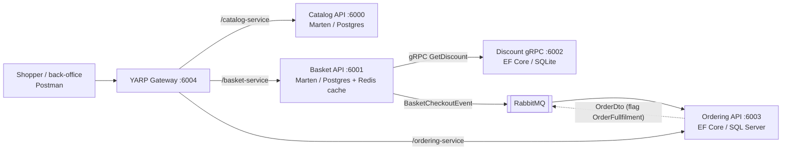
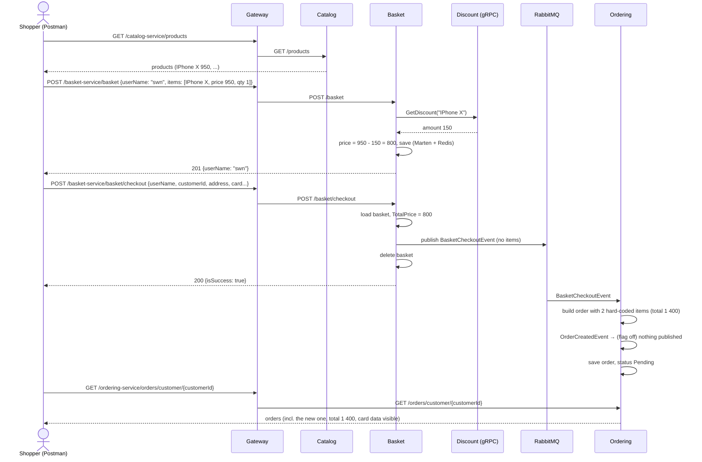

# Use cases — `fastTrack-dev2-ecommerce` (current code)

This document describes what the **current code** in `fastTrack-dev2-ecommerce/src` does, as it is
today (.NET 8, Carter + MediatR + Mapster + Marten). It describes behaviour, not the target design;
for the target design see `template copy.md`.

Each use case lists the endpoint, the input, the steps the code actually performs, the business
rules it enforces, and anything surprising ("Notes").

---

## Contents

1. [Actors and system overview](#1-actors-and-system-overview)
2. [Catalog service](#2-catalog-service)
3. [Basket service](#3-basket-service)
4. [Discount service (gRPC)](#4-discount-service-grpc)
5. [Ordering service](#5-ordering-service)
6. [API gateway (YARP)](#6-api-gateway-yarp)
7. [End-to-end scenario: buy a product](#7-end-to-end-scenario-buy-a-product)
8. [Cross-cutting behaviour](#8-cross-cutting-behaviour)
9. [What the system does not do](#9-what-the-system-does-not-do)

---

## 1. Actors and system overview

| Actor | Who | How they interact |
|---|---|---|
| **Shopper** | Anyone calling the API (Postman today; there is no web UI in this repo) | Gateway → Catalog, Basket, Ordering |
| **Back-office user** | Same as Shopper — the code has **no authentication or roles** | Same endpoints: create/update/delete products and orders |
| **Basket service** | System actor | Calls Discount over gRPC; publishes `BasketCheckoutEvent` |
| **Ordering service** | System actor | Consumes `BasketCheckoutEvent`; may publish `OrderDto` |
| **Developer** | Runs the stack | Seed data on startup, `/health`, RabbitMQ UI |

Ports are the host ports from `docker-compose.override.yml`. Every service also exposes HTTPS on
`606x`.

**Use-case index**

| Id | Use case | Service | Endpoint |
|---|---|---|---|
| UC-C1 | List products | Catalog | `GET /products` |
| UC-C2 | View a product | Catalog | `GET /products/{id}` |
| UC-C3 | Browse a category | Catalog | `GET /products/category/{category}` |
| UC-C4 | Create a product | Catalog | `POST /products` |
| UC-C5 | Update a product | Catalog | `PUT /products` |
| UC-C6 | Delete a product | Catalog | `DELETE /products/{id}` |
| UC-B1 | View a basket | Basket | `GET /basket/{userName}` |
| UC-B2 | Save a basket (applies discounts) | Basket | `POST /basket` |
| UC-B3 | Delete a basket | Basket | `DELETE /basket/{userName}` |
| UC-B4 | Check out a basket | Basket | `POST /basket/checkout` |
| UC-D1 | Get a product's discount | Discount | gRPC `GetDiscount` |
| UC-D2 | Create / update / delete a discount | Discount | gRPC `CreateDiscount`, `UpdateDiscount`, `DeleteDiscount` |
| UC-O1 | Create an order | Ordering | `POST /orders` |
| UC-O2 | Update an order | Ordering | `PUT /orders` |
| UC-O3 | Delete an order | Ordering | `DELETE /orders/{id}` |
| UC-O4 | List orders (paged) | Ordering | `GET /orders` |
| UC-O5 | Find orders by name | Ordering | `GET /orders/{orderName}` |
| UC-O6 | Find orders by customer | Ordering | `GET /orders/customer/{customerId}` |
| UC-O7 | Create an order from a checkout | Ordering | consumes `BasketCheckoutEvent` |
| UC-O8 | Announce a new order | Ordering | publishes `OrderDto` |
| UC-G1 | Route and rate-limit requests | Gateway | `/{service}-service/*` |
| UC-X1 | Seed demo data | Catalog, Ordering, Discount | on startup |
| UC-X2 | Check service health | all HTTP services | `GET /health` |

---

## 2. Catalog service

Products are Marten documents in Postgres (`CatalogDb`). A product has `Id`, `Name`,
`Category` (list of strings), `Description`, `ImageFile`, `Price`. There is no stock.

### UC-C1 — List products

- **Endpoint:** `GET /products?pageNumber=1&pageSize=10`
- **Steps:** Marten `ToPagedListAsync(pageNumber, pageSize)`.
- **Output:** `200 { "products": [ ... ] }`
- **Notes:**
  - Paging is **1-based** (`pageNumber`), while Ordering is 0-based (`PageIndex`).
  - The response has no total count or page info, only the list.
  - No sorting or search.

### UC-C2 — View a product

- **Endpoint:** `GET /products/{id}`
- **Steps:** Marten `LoadAsync<Product>(id)`.
- **Output:** `200 { "product": { ... } }`; `404` (`ProductNotFoundException`) if missing.

### UC-C3 — Browse a category

- **Endpoint:** `GET /products/category/{category}`
- **Steps:** returns products whose `Category` list contains the value (exact match, case-sensitive).
- **Output:** `200 { "products": [ ... ] }` (empty list if none, not 404).

### UC-C4 — Create a product

- **Endpoint:** `POST /products`
- **Input:** `{ name, category: [..], description, imageFile, price }`
- **Rules:** `name`, `category`, `imageFile` required; `price > 0`.
- **Steps:** build `Product`, `session.Store`, `SaveChangesAsync`. Marten generates the `Id`.
- **Output:** `201 { "id": "..." }`, `Location: /products/{id}`; `400` with `ValidationErrors` if a
  rule fails.
- **Notes:** no check for duplicate names; anyone can call it.

### UC-C5 — Update a product

- **Endpoint:** `PUT /products` (the id is **in the body**, not the URL)
- **Input:** `{ id, name, category, description, imageFile, price }`
- **Rules:** `id` required; `name` 2–150 chars; `price > 0`.
- **Steps:** load → 404 if missing → overwrite every field → save.
- **Output:** `200 { "isSuccess": true }`
- **Notes:** a price change is **not** propagated anywhere; baskets keep the old price.

### UC-C6 — Delete a product

- **Endpoint:** `DELETE /products/{id}`
- **Steps:** `session.Delete<Product>(id)`, save.
- **Output:** always `200 { "isSuccess": true }`, **even if the product doesn't exist**.
- **Notes:** baskets, discounts and Ordering's own `Products` table still reference the product.

---

## 3. Basket service

A basket (`ShoppingCart`) is a Marten document in a second Postgres (`BasketDb`), keyed by
`UserName`, with a Redis copy in front of it (`CachedBasketRepository`, decorated with Scrutor).
Each item has `ProductId`, `ProductName`, `Price`, `Quantity`, `Color`. `TotalPrice` =
Σ `Price × Quantity`.

### UC-B1 — View a basket

- **Endpoint:** `GET /basket/{userName}`
- **Steps:** read Redis key `{userName}`; on a miss, load from Marten and write it to Redis (no
  expiry).
- **Output:** `200 { "cart": { userName, items, totalPrice } }`; `404` (`BasketNotFoundException`)
  if the user has no basket.
- **Notes:** the user name comes from the URL, so anyone can read anyone's basket.

### UC-B2 — Save a basket (applies discounts)

- **Endpoint:** `POST /basket`
- **Input:** `{ "cart": { userName, items: [{ productId, productName, price, quantity, color }] } }`
- **Rules:** `cart` not null; `userName` required.
- **Steps:**
  1. For **each item**, call Discount `GetDiscount(productName)` over gRPC.
  2. `item.Price -= coupon.Amount`.
  3. Upsert the whole cart in Marten, then overwrite the Redis copy.
- **Output:** `201 { "userName": "..." }`, `Location: /basket/{userName}`.
- **Notes:**
  - The **price comes from the client**; Catalog is never consulted.
  - The discount is applied to whatever price is sent. Saving a cart that was read back with
    UC-B1 (already discounted) **subtracts the discount again**; the price can go negative.
  - Quantity is not validated (0 or negative is accepted).
  - The whole basket is replaced on each call; there is no "add one item" operation.

### UC-B3 — Delete a basket

- **Endpoint:** `DELETE /basket/{userName}`
- **Steps:** delete from Marten, remove the Redis key.
- **Output:** `200 { "isSuccess": true }` (also when there was no basket).

### UC-B4 — Check out a basket

- **Endpoint:** `POST /basket/checkout`
- **Input:** `{ "basketCheckoutDto": { userName, customerId, totalPrice, firstName, lastName,
  emailAddress, addressLine, country, state, zipCode, cardName, cardNumber, expiration, cvv,
  paymentMethod } }`
- **Rules:** `basketCheckoutDto` not null; `userName` required.
- **Steps:**
  1. Load the basket (UC-B1 path) → `404` if missing.
  2. Map the DTO to `BasketCheckoutEvent` with Mapster; overwrite `TotalPrice` with the basket's.
  3. Publish the event to RabbitMQ (MassTransit).
  4. Delete the basket (UC-B3).
- **Output:** `200 { "isSuccess": true }`
- **Notes:**
  - The event carries the **address and the full card data (number, expiry, CVV)** but **not
    the basket items**.
  - `customerId` is whatever the client sends; nothing checks it.
  - The `basket == null → IsSuccess=false` branch is unreachable: the repository throws 404 first.
  - Publishing and deleting are not atomic: if the delete fails after the publish, the basket stays
    and can be checked out twice.

---

## 4. Discount service (gRPC)

Coupons live in SQLite (`discountdb` file inside the container), with EF Core migrations. A coupon
has `Id`, `ProductName`, `Description`, `Amount` (an integer amount of money, not a percentage).
Contract: `Protos/discount.proto`. The service is **not routed by the gateway**; only Basket calls
it, and only `GetDiscount`.

### UC-D1 — Get a product's discount

- **RPC:** `GetDiscount({ productName })`
- **Steps:** first coupon with that exact `ProductName`.
- **Output:** the coupon, or `{ productName: "No Discount", amount: 0 }` when none exists.
- **Seed:** `IPhone X` → 150, `Samsung 10` → 100.

### UC-D2 — Create / update / delete a discount

| RPC | Input | Behaviour |
|---|---|---|
| `CreateDiscount` | `{ coupon }` | Inserts the coupon, returns it with its new `id` |
| `UpdateDiscount` | `{ coupon }` (with `id`) | `Update` by id, returns it |
| `DeleteDiscount` | `{ productName }` | Deletes the first match; `NotFound` RPC error if none |

- **Notes:**
  - Coupons are matched by **product name**, so renaming a product in Catalog loses its discount.
  - No validation (negative amounts, duplicate product names are accepted).
  - Only callable with a gRPC client (`grpcurl`, Postman gRPC); the endpoint is HTTP/2 only.
  - `UseMigration()` starts `MigrateAsync()` without awaiting it, so the first request after a fresh
    start can hit a missing table.

---

## 5. Ordering service

Clean Architecture (Api / Application / Domain / Infrastructure), EF Core on SQL Server (`OrderDb`),
MediatR commands/queries, Carter endpoints.

**Domain model**

- `Order` (aggregate): `Id`, `CustomerId`, `OrderName`, `ShippingAddress`, `BillingAddress`,
  `Payment`, `Status` (`Draft`, `Pending`, `Completed`, `Cancelled`), `OrderItems`, `TotalPrice`
  (Σ price × quantity).
- `OrderItem`: `ProductId`, `Quantity`, `Price`.
- `Customer` (`Name`, unique `Email`) and `Product` (`Name`, `Price`) tables exist **inside
  Ordering**; orders and order items have foreign keys to them.
- Value objects with rules: ids not empty; `OrderName` not blank; `Address` needs `EmailAddress` and
  `AddressLine`; `Payment` needs `CardName`, `CardNumber`, `CVV` (≤ 3 chars); item `Quantity > 0`,
  `Price > 0`.
- Domain events: `Order.Create` raises `OrderCreatedEvent`; `Order.Update` raises
  `OrderUpdatedEvent`. A `SaveChangesInterceptor` dispatches them through MediatR **before** the
  database commit.
- An audit interceptor sets `CreatedAt/By`, `LastModified/By` (`By` is always `"mehmet"`).

`OrderDto` (used for input and output):
`{ id, customerId, orderName, shippingAddress, billingAddress, payment: { cardName, cardNumber,
expiration, cvv, paymentMethod }, status, orderItems: [{ orderId, productId, quantity, price }] }`

### UC-O1 — Create an order

- **Endpoint:** `POST /orders`
- **Input:** `{ "order": OrderDto }` (the `id` in the body is ignored; a new one is generated)
- **Rules:** `orderName` required; `customerId` not null; `orderItems` not empty; plus the domain
  rules above.
- **Steps:** build `Order` from the DTO → add each item → `SaveChanges` → `OrderCreatedEvent`
  (→ UC-O8).
- **Output:** `201 { "id": "..." }`, `Location: /orders/{id}`.
- **Notes:**
  - `customerId` must be one of the seeded customers and every `productId` one of the 4 seeded
    Ordering products, or the insert fails on a foreign key (→ 500).
  - Item prices come from the request; nothing checks them against Catalog.
  - Domain-rule failures (`ArgumentException`, `DomainException`) return **500**, not 400.
  - The order is created with `Status = Pending` regardless of the `status` sent.

### UC-O2 — Update an order

- **Endpoint:** `PUT /orders` (id in the body)
- **Input:** `{ "order": OrderDto }`
- **Rules:** `id`, `orderName` required; `customerId` not null.
- **Steps:** find → 404 if missing → `Order.Update(name, shipping, billing, payment, status)` →
  save → `OrderUpdatedEvent` (only logged).
- **Output:** `200 { "isSuccess": true }`
- **Notes:** items and customer **cannot** be changed; any status transition is allowed (e.g.
  `Cancelled` → `Pending`). This is the only way an order changes status.

### UC-O3 — Delete an order

- **Endpoint:** `DELETE /orders/{id}`
- **Steps:** find → 404 if missing → remove (items cascade) → save.
- **Output:** `200 { "isSuccess": true }`

### UC-O4 — List orders (paged)

- **Endpoint:** `GET /orders?PageIndex=0&PageSize=10`
- **Steps:** total count, then orders with items ordered by `OrderName`, skip/take.
- **Output:** `200 { "orders": { pageIndex, pageSize, count, data: [OrderDto] } }`
- **Notes:** returns every customer's orders, including **card number and CVV**.

### UC-O5 — Find orders by name

- **Endpoint:** `GET /orders/{orderName}`
- **Steps:** orders whose `OrderName` contains the value.
- **Output:** `200 { "orders": [OrderDto] }`

### UC-O6 — Find orders by customer

- **Endpoint:** `GET /orders/customer/{customerId}`
- **Output:** `200 { "orders": [OrderDto] }`
- **Notes:** no check that the caller is that customer.

### UC-O7 — Create an order from a checkout (event consumer)

- **Trigger:** `BasketCheckoutEvent` from RabbitMQ (UC-B4).
- **Steps:**
  1. Build an `OrderDto` from the event: `OrderName = userName`, the same address for shipping and
     billing, payment from the card fields, `Status = Pending`.
  2. **Order items are hard-coded:** 2 × product `5334c996…` at 500 and 1 × product `c67d6323…` at
     400, whatever was in the basket.
  3. Send `CreateOrderCommand` (same path as UC-O1).
- **Notes:**
  - Works only if `customerId` is a seeded customer; otherwise the FK fails and MassTransit retries
    the message, then moves it to the `_error` queue.
  - `TotalPrice` from the event is ignored; the order total is always 1 400.

### UC-O8 — Announce a new order

- **Trigger:** `OrderCreatedEvent` domain event (UC-O1, UC-O7, and the seed in UC-X1).
- **Steps:** if feature flag `OrderFullfilment` is on, publish the whole `OrderDto` to RabbitMQ.
- **Notes:**
  - The flag is `false` in both `appsettings.json` and compose, so nothing is published by default.
  - No service consumes the message.
  - It is published **before** the order is committed, so a failed insert can still announce an
    order. The message includes the card data.

---

## 6. API gateway (YARP)

### UC-G1 — Route and rate-limit requests

| Public path | Goes to | Rate limit |
|---|---|---|
| `/catalog-service/{**}` | Catalog `:8080` | none |
| `/basket-service/{**}` | Basket `:8080` | none |
| `/ordering-service/{**}` | Ordering `:8080` | fixed window: **5 requests / 10 s** (then `503`) |

- The prefix is stripped (`/catalog-service/products` → `/products`).
- Discount is not routed. `appsettings.Local.json` points the clusters at `localhost:600x` for IDE runs.
- No authentication, CORS or static files.

---

## 7. End-to-end scenario: buy a product

What the shopper sees: they put one IPhone X at 800 in the basket, and the resulting order contains
2 × IPhone X + 1 × Samsung 10 for 1 400. No money is taken; the order stays `Pending` until someone
calls UC-O2.

**Payment today** is only data copying: card fields go client → Basket → RabbitMQ → Ordering →
SQL Server columns, and are returned by every order query. Nothing charges the card or verifies it.

---

## 8. Cross-cutting behaviour

| Concern | Behaviour |
|---|---|
| **Authentication / authorization** | None. Every endpoint is public; user identity is whatever is in the URL or body |
| **Validation** | FluentValidation validators on **commands only** (`ValidationBehavior` is constrained to `ICommand`), run by the MediatR pipeline. Failures → `400` with `ValidationErrors`. Queries are not validated |
| **Errors** | `CustomExceptionHandler`: `NotFoundException` → 404, `BadRequestException` / `ValidationException` → 400, everything else (including domain-rule `ArgumentException`) → 500. Body is `ProblemDetails` with the exception message and type name |
| **Logging** | `LoggingBehavior` logs start/end of every MediatR request, with the full request data (card numbers included for orders), and a warning above 3 s |
| **Health** | `GET /health` on Catalog (Postgres), Basket (Postgres + Redis), Ordering (SQL Server). Discount and the gateway have none |
| **Messaging** | MassTransit over RabbitMQ, kebab-case queues, default retry; no outbox, no de-duplication (`IntegrationEvent.Id` is a new Guid on every read) |
| **Environments** | `ASPNETCORE_ENVIRONMENT=Development` in compose: seeding and migrations run on every start |

### UC-X1 — Seed demo data (Development)

| Service | Data |
|---|---|
| Catalog | 7 products (IPhone X 950, Samsung 10 840, Huawei Plus 650, Xiaomi Mi 9 470, HTC U11+ Plus 380, LG G7 ThinQ 240, Panasonic Lumix 240), only if the store is empty |
| Discount | 2 coupons (IPhone X 150, Samsung 10 100), via EF `HasData` |
| Ordering | 2 customers (mehmet, john), 4 products (its own copies, with **different prices** from Catalog: IPhone X 500, Samsung 10 400…), 2 orders `ORD_1`, `ORD_2` |

### UC-X2 — Check service health

`GET /health` returns the HealthChecks UI JSON (`status`, per-dependency entries).

---

## 9. What the system does not do

These are gaps in the current code, not use cases:

- No users, login or roles; no way to tell a shopper from an admin.
- No web UI in this repo (the README mentions a Razor "Shopping.Web", which is not included).
- No payment: no charge, no payment status, card data stored in plain text.
- No stock: products can be ordered without limit; nothing decrements anything.
- Basket prices are not checked against Catalog, and discounts can be applied repeatedly.
- Checkout does not send the basket items; orders get fixed demo items.
- Catalog and Ordering hold separate product lists that are never synchronised.
- Price changes, product deletions and order creation are not propagated to other services (the
  only event that is actually consumed is `BasketCheckoutEvent`).
- No order lifecycle rules: any status can be set at any time through `PUT /orders`.
